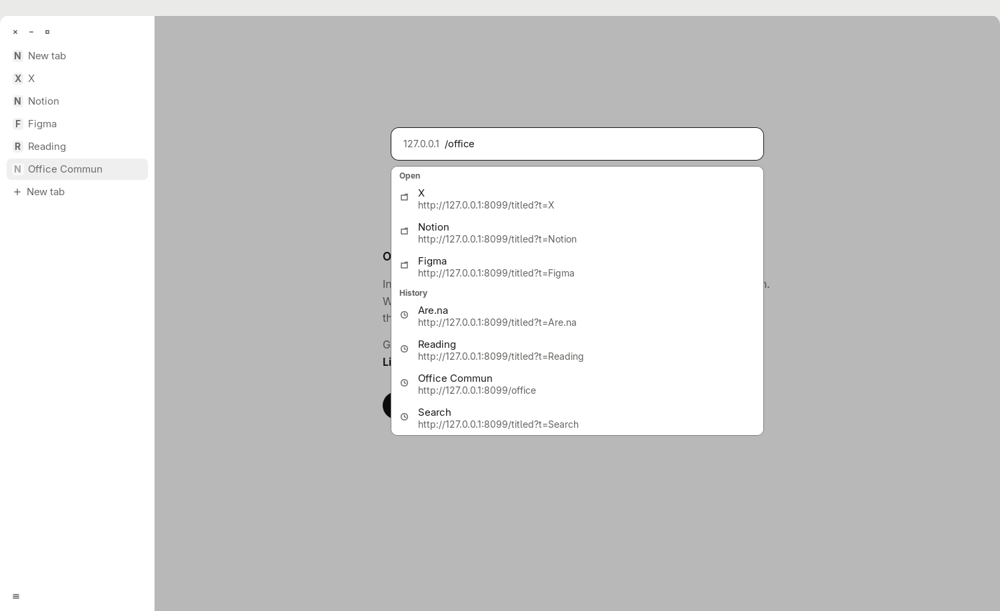
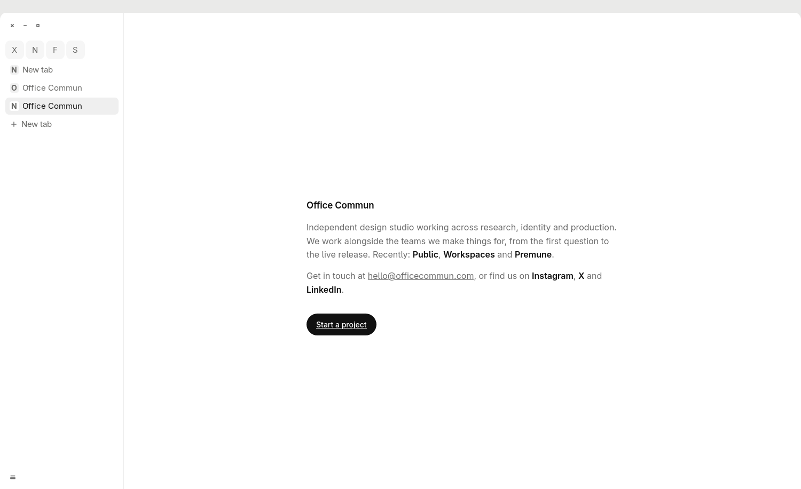

<div align="center">


### A small, quiet WebKit browser for Linux.

**Vertical tabs · Rust shell · Shared WebKit engine · Local-first**

[](Cargo.toml)
[](docs/ARCHITECTURE.md)
[](LICENSE)
[](#build-and-run)

[Explore the browser](#the-browser) · [Build it](#build-and-run) · [Architecture](#architecture) · [Testing](#testing)

</div>

---

## The browser

No toolbar. No account. No bundled Chromium. A column of tabs and the page.

<table>
  <tr>
    <td width="50%"><strong>Light</strong><br><sub>Quiet chrome, readable pages.</sub></td>
    <td width="50%"><strong>Dark</strong><br><sub>The same interface, after hours.</sub></td>
  </tr>
  <tr>
    <td></td>
    <td></td>
  </tr>
  <tr>
    <td><strong>One field</strong><br><sub>Addresses, search, history and open tabs.</sub></td>
    <td><strong>Pinned pages</strong><br><sub>Daily pages stay within reach.</sub></td>
  </tr>
  <tr>
    <td></td>
    <td></td>
  </tr>
</table>

<details>
<summary><strong>More real screenshots: reading, history and settings</strong></summary>
<br>
<table>
  <tr>
    <td></td>
    <td></td>
  </tr>
  <tr>
    <td align="center"><strong>Reading mode</strong><br><sub>The article, set in the browser's own type.</sub></td>
    <td align="center"><strong>History</strong><br><sub>Local, searchable and under your control.</sub></td>
  </tr>
</table>


</details>

## What it does

| Area | What you get |
|---|---|
| **Browse** | Vertical tabs, pinned pages, session restore, lazy restored tabs, window-size memory. |
| **Search** | One field for addresses and words. Suggestions come from your tabs, history and bookmarks. |
| **Privacy** | EasyList and EasyPrivacy enforced by WebKit before requests are made. No telemetry. |
| **Reading** | Distraction-free articles, in-page find, bookmarks and a searchable local history. |
| **Control** | Hide page elements persistently, private tabs, light/dark appearance, keyboard-first controls. |
| **Extensions** | `.crx`, `.xpi` and unpacked folders: content scripts, styles and options pages within WebKit's limits. |

> **A real browser, with explicit limits.** No sync, cloud account, password manager, multiple windows or full WebExtensions API. DRM video is unavailable. Read [differences from the original](docs/DIFFERENCES.md) and [technical limits](docs/LIMITS.md).

## Why this architecture

```text
┌─────────────────────── Search ───────────────────────┐
│ Rust application + GTK 3 interface                  │
│ tabs · omnibox · panels · reader · local JSON state │
└───────────────────────┬──────────────────────────────┘
                        │ distribution libraries
┌───────────────────────▼──────────────────────────────┐
│ WebKitGTK 4.1                                       │
│ web process · network process · content blocking    │
└─────────────────────────────────────────────────────┘
```

- **No second engine.** WebKitGTK comes from your distribution, not a bundled Chromium download.
- **A tab starts on demand.** Restored background tabs do not create a web process until selected.
- **Local by default.** Tabs, history, bookmarks and hidden elements are small JSON files in your own folders.
- **One concern per module.** Browser behavior, rendering, UI, panels, extensions, storage and tests remain inspectable.

### Languages

Measured across `src/`, `tools/` and `assets/` in this checkout:

| Language | Share | Role |
|---|---:|---|
| 🦀 **Rust** | **76.9%** | Browser, native UI, state, networking integration and tests. |
| 🐍 **Python** | **19.6%** | Browser automation, stress tests, fixtures and visual evidence. |
| 🐚 **Shell** | **2.6%** | Reproducible screenshot capture and developer workflows. |
| 🟨 **JavaScript** | **1.0%** | Reading mode and page-side behavior. |

## Project structure

```text
search-linux/
├── src/                 Rust browser and GTK interface
│   ├── app.rs          Tabs, actions and application state
│   ├── web.rs          WebKit views, navigation and downloads
│   ├── ui.rs           Native widgets and window chrome
│   ├── panels.rs       History, settings, shortcuts and extensions
│   ├── reader.rs       Reading-mode integration
│   └── bench.rs        Automation socket used by the test suite
├── assets/
│   ├── reader.js       Page-side reading mode
│   └── shield/         Compiled content-blocking rules
├── tools/
│   ├── stress.py       Browser stress, behavior and memory checks
│   ├── shots.sh        Light/dark screenshot evidence
│   ├── fixtures.py     Local hostile and ordinary test pages
│   └── bench.py        Automation client
├── docs/               Architecture, limits, screenshots and decisions
├── reference/          Original-browser visual references
└── council/            Verified review rounds and evidence
```

## Build and run

### Requirements

- Rust **1.75+**
- GTK **3**
- WebKitGTK **4.1**
- A Wayland or X11 session

Arch package: `webkit2gtk-4.1`. Debian/Ubuntu package: `libwebkit2gtk-4.1-dev`.

```sh
cargo build --release
./target/release/search
```

No Node. No bundler. No submodule. The stripped release binary is about **2.8 MB**.

<details>
<summary><strong>Install a launcher and handle web links</strong></summary>

```sh
cargo install --path . --root ~/.local
mkdir -p ~/.local/share/applications
cat > ~/.local/share/applications/search.desktop <<'EOF'
[Desktop Entry]
Type=Application
Name=Search
Comment=A small, fast, quiet browser
Exec=search %u
Terminal=false
Categories=Network;WebBrowser;
MimeType=x-scheme-handler/http;x-scheme-handler/https;
EOF
xdg-mime default search.desktop x-scheme-handler/https
```

There is no AppImage, Flatpak or installer yet: one binary plus one desktop file.

</details>

## Testing

```sh
cargo test --release
python3 tools/stress.py
python3 tools/extensions.py
python3 tools/check_shield.py
tools/shots.sh council/latest
SHOT_DARK=1 tools/shots.sh council/latest-dark
python3 tools/report_figures.py --check
```

The stress suite drives real browser behavior: many tabs, hostile pages, redirects, stalled loads, downloads, privacy, reading mode, keyboard actions, panels, scrolling and memory pressure. It writes `build/stress-report.json` and exits non-zero on failure.

Latest verified candidate: **123 Rust tests and 92/92 browser checks**. Screenshots above come from the same candidate's light and dark evidence runs.

## Memory, honestly

**The requested ~100 MB total-RAM target is not met.** The latest full-suite sample measured **210.5 MB total PSS** for one idle tab, including **91.7 MB anonymous PSS**. Total memory varies with WebKit, graphics initialization, page content and host state.

The suite records both figures and includes `target_pss_mb: 100` plus `target_met`. It does not present anonymous memory as total memory. Settings → **Use less memory** reduces compositing cost on the next launch, but does not make the total target pass.

See [docs/LIMITS.md](docs/LIMITS.md) for the exact measurement, process model, multi-tab cost and known tradeoffs.

## Keyboard essentials

| Action | Key | Action | Key |
|---|---|---|---|
| Address/search field | `Ctrl L` | New tab | `Ctrl T` |
| Private tab | `Ctrl Shift N` | Close tab | `Ctrl W` |
| Next / previous tab | `Ctrl Tab` / `Ctrl Shift Tab` | Reopen tab | `Ctrl Shift T` |
| Reading mode | `Ctrl Shift R` | Find in page | `Ctrl F` |
| Bookmark | `Ctrl D` | History | `Ctrl Y` |
| Downloads | `Ctrl J` | Settings | `Ctrl ,` |
| Hide an element | `Ctrl Shift H` | Restore hidden elements | `Ctrl Shift U` |
| All shortcuts | `Ctrl /` | Close the current overlay | `Escape` |

## Origin and license

Search was created for macOS by [Office Commun](https://officecommun.com), at [driceroland/Search](https://github.com/driceroland/Search). This is an independent Linux implementation in Rust, using the same interface idea and WebKitGTK.

MIT. See [LICENSE](LICENSE). Contribution workflow: [CONTRIBUTING.md](CONTRIBUTING.md). Release history: [CHANGELOG.md](CHANGELOG.md).
