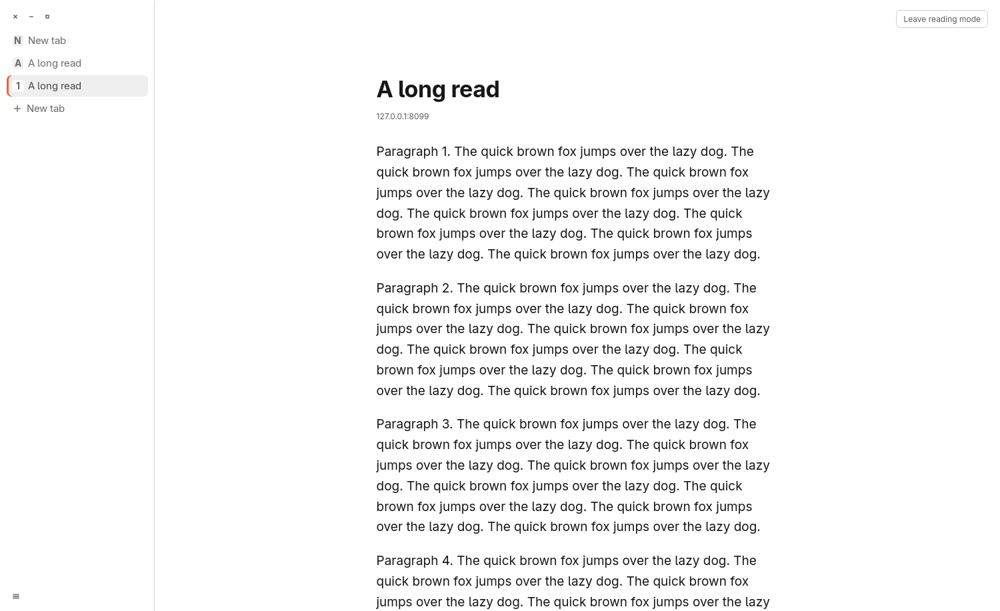
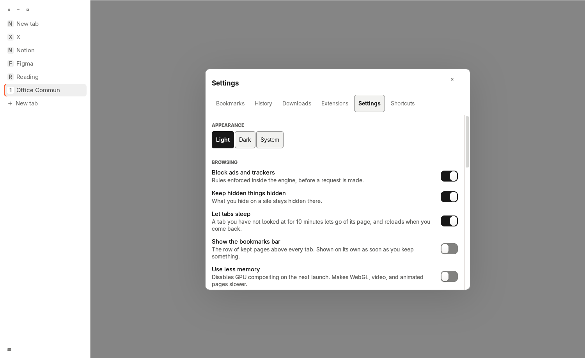

<div align="center">


### A small, quiet, native WebKit browser for Linux.

**Edge-to-edge chrome · Vertical tabs · VSync motion · Local-first · Shared WebKitGTK engine**

[](Cargo.toml)
[](docs/ARCHITECTURE.md)
[](#testing)
[](LICENSE)
[](#build-from-source)

[Highlights](#highlights) · [Screenshots](#screenshots) · [AppImage](#appimage) · [Build](#build-from-source) · [Shortcuts](#keyboard-shortcuts) · [Architecture](#architecture) · [Testing](#testing)

</div>

---

**Search** is an independent Linux implementation of [Office Commun's Search](https://github.com/driceroland/Search), written in Rust with GTK 3 and WebKitGTK 4.1. No Electron, no bundled Chromium, no account, and no top toolbar clutter — just a foldable column of vertical tabs and the web page.

## Highlights

- **Edge-to-edge interface**: No top chrome strip or tab bar clutter. A clean, foldable vertical tab column (`Ctrl S`), pinned pages, and a single keyboard-first omnibox (`Ctrl L`).
- **Fluid native motion**: Driven by a custom VSync `gdk::FrameClock` engine (`src/motion.rs`) and GTK CSS transitions — smooth overlay slides/fades, 90 ms tab crossfades, animated sidebar folding, floating hover controls, and a 3 px top page-load progress bar.
- **Built for the real web**: Persistent SQLite cookies in normal tabs (strictly isolated ephemeral storage in private tabs), WebRTC, `prefers-color-scheme` sync, locale-derived `Accept-Language` and spellcheck, clipboard permission prompts, and server-suggested download filenames.
- **Engine-level privacy**: EasyList and EasyPrivacy compiled into **15,775 WebKit content-blocker rules** across 3 lists (`network`, global cosmetic, and domain-scoped `if-domain` rules) enforced inside WebKit before requests leave the browser.
- **Fast and lazy by default**: Restored background tabs stay asleep with zero web process until selected. Tab switches average **1.0 ms** (**1.7 ms p95**, **6.5 ms worst** over 300 switches).
- **Power features without bloat**: `Shift` + click link peek cards, `Ctrl I` site security/zoom/permissions/data card, sanitized reading mode (`Ctrl Shift R`), persistent element hiding in an isolated script world (`Ctrl Shift H`), closed-tab stack (`Ctrl Shift T`), `.crx`/`.xpi`/unpacked content-script extensions, and 6-browser import (Firefox, Chromium, Chrome, Brave, Edge, Vivaldi).

> **Explicit scope & limits.** Search has no cloud sync, user accounts, built-in password manager, multi-window mode, or DRM/EME playback. Read [differences from the original](docs/DIFFERENCES.md) and [technical limits](docs/LIMITS.md).

## Screenshots

<table>
  <tr>
    <td width="50%"><strong>Light</strong><br><sub>Edge-to-edge page, quiet vertical tab column.</sub></td>
    <td width="50%"><strong>Dark</strong><br><sub>Synced desktop/app theme while respecting each site's own colors.</sub></td>
  </tr>
  <tr>
    <td></td>
    <td></td>
  </tr>
  <tr>
    <td><strong>Omnibox</strong> (<code>Ctrl L</code>)<br><sub>Addresses, search suggestions, history, bookmarks, and open tabs in one place.</sub></td>
    <td><strong>Pinned pages</strong><br><sub>Daily sites stay compact at the top of the column.</sub></td>
  </tr>
  <tr>
    <td></td>
    <td></td>
  </tr>
</table>

<details>
<summary><strong>More screenshots: Reading mode, History, and Settings</strong></summary>
<br>
<table>
  <tr>
    <td></td>
    <td></td>
  </tr>
  <tr>
    <td align="center"><strong>Reading mode</strong> (<code>Ctrl Shift R</code>)<br><sub>Sanitized article typography without page clutter.</sub></td>
    <td align="center"><strong>History</strong> (<code>Ctrl H</code> / <code>Ctrl Y</code>)<br><sub>Local, fast, and searchable.</sub></td>
  </tr>
</table>



</details>

## AppImage

An **x86_64 / AMD64** AppImage bundles Search, WebKitGTK 4.1, its process helpers, GStreamer plugins, fonts, and the GTK 3 runtime. No installation or root access required.

```sh
chmod +x Search-1.0.1-x86_64.AppImage
./Search-1.0.1-x86_64.AppImage
```

You can also rebuild it directly from this repository:

```sh
tools/appimage.sh
```

See [packaging/README.md](packaging/README.md) for verification, desktop-entry installation, and glibc compatibility notes.

## Build from source

### Requirements

- **Rust 1.75+**
- **GTK 3** and **WebKitGTK 4.1** (`webkit2gtk-4.1` on Arch, `libwebkit2gtk-4.1-dev` on Debian/Ubuntu)
- A Wayland or X11 session

```sh
cargo build --release
./target/release/search
```

No Node, no JS bundler, no submodules. The stripped release binary is **~3.8 MB**.

<details>
<summary><strong>Install desktop launcher &amp; handle HTTP/HTTPS links</strong></summary>

```sh
cargo install --path . --root ~/.local
mkdir -p ~/.local/share/applications
cat > ~/.local/share/applications/search.desktop <<'EOF'
[Desktop Entry]
Type=Application
Name=Search
Comment=A small, fast, quiet browser
Exec=search %u
Terminal=false
Categories=Network;WebBrowser;
MimeType=x-scheme-handler/http;x-scheme-handler/https;
EOF
xdg-mime default search.desktop x-scheme-handler/https
xdg-mime default search.desktop x-scheme-handler/http
```

</details>

## Keyboard shortcuts

| Navigation & Tabs | Key | Page, Panels & Tools | Key |
|---|---|---|---|
| Address / search field | `Ctrl L` | Find in page | `Ctrl F` |
| New tab / Private tab | `Ctrl T` / `Ctrl Shift N` | Reading mode | `Ctrl Shift R` |
| Close / Reopen tab | `Ctrl W` / `Ctrl Shift T` | Site info, zoom & permissions | `Ctrl I` |
| Next / Previous tab | `Ctrl Tab` / `Ctrl Shift Tab` | Peek link in floating card | `Shift` + click |
| Switch tab by typing | `Ctrl K` | Bookmark page | `Ctrl D` |
| Duplicate tab | `Ctrl Shift K` | History / Downloads | `Ctrl H` (`Ctrl Y`) / `Ctrl J` |
| Fold / unfold tab column | `Ctrl S` | Hide element / Restore hidden | `Ctrl Shift H` / `Ctrl Shift U` |
| Settings / All shortcuts | `Ctrl ,` / `Ctrl /` | Dismiss current overlay | `Escape` |

## Architecture

```text
┌─────────────────────── Search (Rust + GTK 3) ───────────────────────┐
│ app.rs · ui.rs · motion.rs · omnibox.rs · panels.rs · sitecard.rs   │
│ peek.rs · curtain.rs · extensions.rs · store.rs · reader.rs         │
└──────────────────────────────────┬──────────────────────────────────┘
                                   │ distribution WebKitGTK 4.1
┌──────────────────────────────────▼──────────────────────────────────┐
│ WebKitWebView · WebKitNetworkProcess · UserContentFilterStore       │
└─────────────────────────────────────────────────────────────────────┘
```

- **Codebase**: 34 Rust modules in `src/` (**22,972 lines** total — **81.3% Rust**, **15.3% Python**, **2.6% Shell**, **0.8% JS** across `src/`, `tools/`, and `assets/`).
- **Key directories**:
  - `src/` — Browser state (`app.rs`), WebKit integration (`web.rs`), GTK widgets (`ui.rs`), VSync motion (`motion.rs`), overlays (`omnibox.rs`, `panels.rs`, `peek.rs`, `sitecard.rs`, `find.rs`, `dialogs.rs`, `permissions.rs`), privacy/blocking (`shield.rs`, `curtain.rs`, `extensions.rs`), and test socket (`bench.rs`).
  - `assets/` — Sanitized reading mode (`reader.js`) and compiled content-blocker lists (`shield/network.json`, `shield/hide-0.json`, `shield/hide-sites.json`).
  - `tools/` — Stress & memory suite (`stress.py`), visual verification (`shots.sh`), shield compiler & checker (`build_shield.py`, `check_shield.py`), extension tests (`extensions.py`), AppImage packager (`appimage.sh`), and figure checker (`report_figures.py`).
  - `docs/` — [Architecture](docs/ARCHITECTURE.md), [Technical Limits](docs/LIMITS.md), [Testing](docs/TESTING.md), and [Differences](docs/DIFFERENCES.md).

## Testing

```sh
cargo test --release                     # 269 unit tests (1 ignored, 0 failed)
python3 tools/stress.py                  # 117/117 end-to-end & memory checks
GDK_BACKEND=wayland python3 tools/extensions.py
python3 tools/check_shield.py            # 15,775 WebKit rules across 3 lists, 0 rejected
tools/shots.sh council/latest            # 18/18 light states + pixel checks
SHOT_DARK=1 tools/shots.sh council/latest-dark
python3 tools/report_figures.py --check  # Verify docs match build/stress-report.json
```

Screenshots in `docs/screenshots/` come from the verified `council/round-47` and `council/round-47-dark` runs.

## Memory, honestly

**The requested ~100 MB total-RAM target is not met.** The latest full-suite sample measured **about 227 MB total PSS** (218.1 MB exact) for one idle tab, including **96.5 MB anonymous PSS** (see `idle one tab` in [docs/LIMITS.md](docs/LIMITS.md)). Total memory varies with WebKit, graphics initialization, page content, and host state.

The suite records both numbers with `target_pss_mb: 100` and `target_met: false` rather than reporting anonymous memory as total RAM. Settings → **Use less memory** disables GPU compositing on the next launch, trading rendering speed for lower memory.

## Origin and license

Search was created for macOS by [Office Commun](https://officecommun.com) ([driceroland/Search](https://github.com/driceroland/Search)). This is an independent Linux implementation in Rust using GTK 3 and WebKitGTK 4.1.

Licensed under [MIT](LICENSE). See [CONTRIBUTING.md](CONTRIBUTING.md) and [CHANGELOG.md](CHANGELOG.md).
