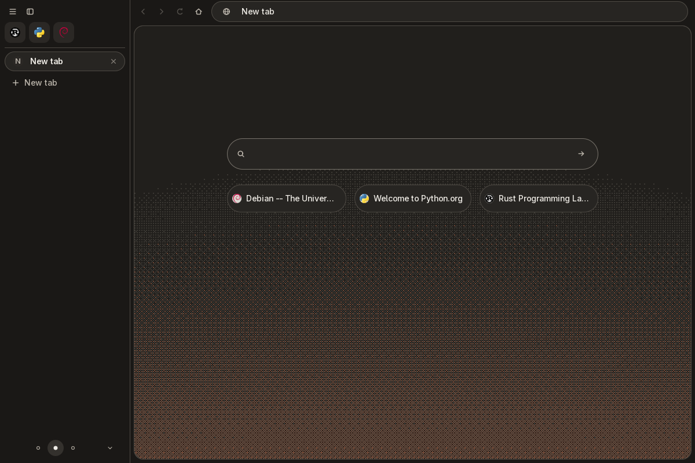
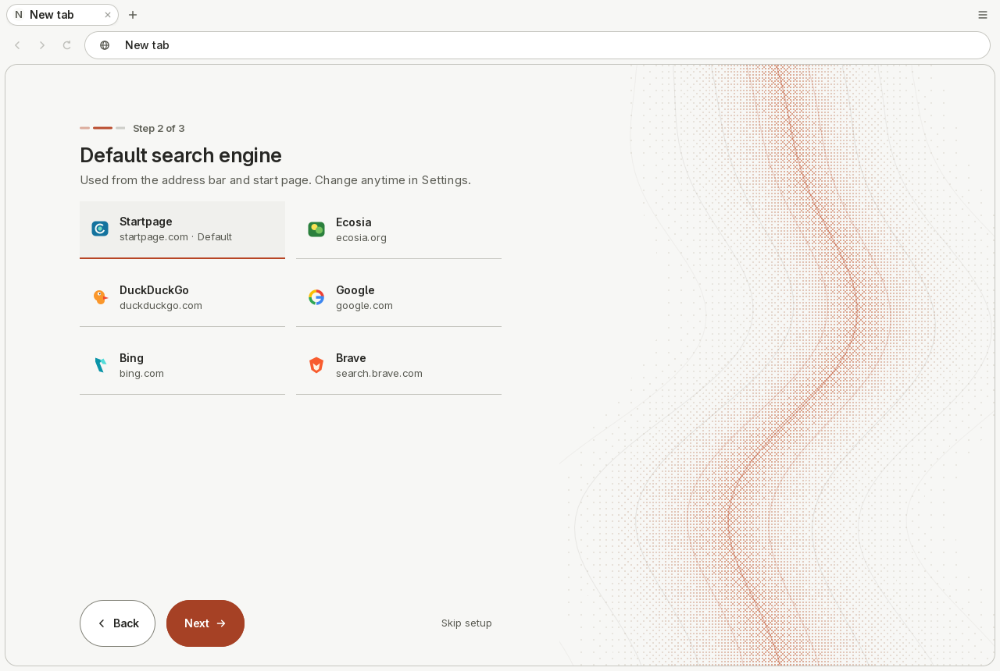
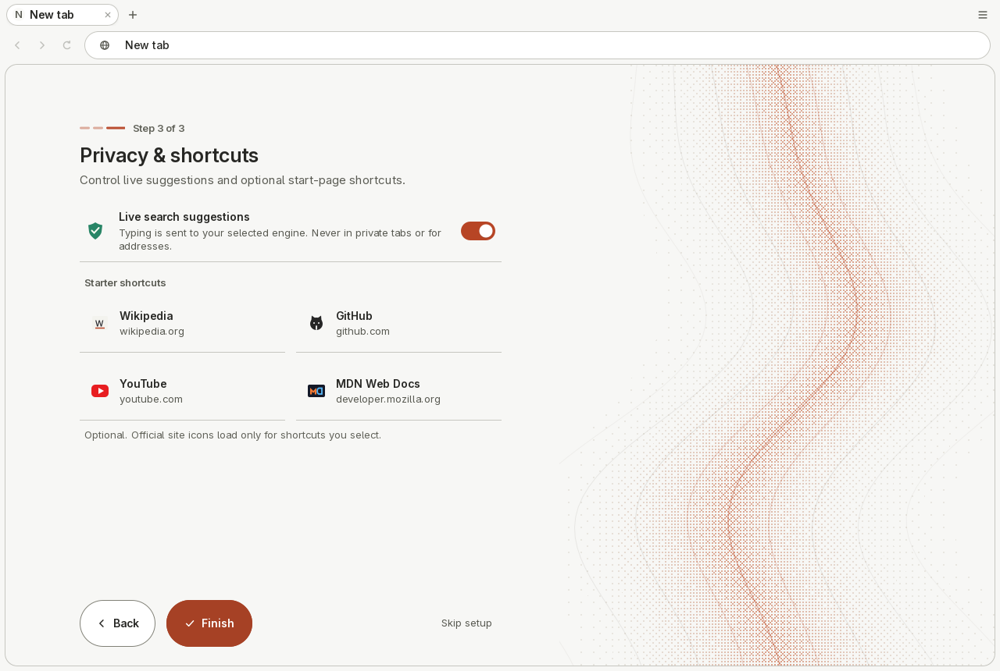

# Rill

A calm, native browser for Linux. Built with Rust, GTK 3, and the WebKitGTK engine your desktop already uses.

Rill stays out of the way: no Electron, no bundled Chromium, no account, and no onboarding modal. Open it, find what you need, and shape the browser around your habits only if you want to.


[Download Rill 1.1.0 for Linux (x86_64 AppImage)](https://github.com/INDAR-Beurre/search-linux/releases/download/v1.1.0/Rill-1.1.0-x86_64.AppImage) · [Release notes and checksum](https://github.com/INDAR-Beurre/search-linux/releases/tag/v1.1.0)

## Why people use it

**It fits the way you work.** Use a familiar tab strip, or press `Ctrl S` to move the tabs into a vertical sidebar. Pinned sites collapse into a small icon rail. Tabs can be dragged into a new order.

**Spaces keep projects apart.** Start with Default. Add spaces for work, study, or anything else. Each space keeps its own tabs and active page, so switching back feels like putting a desk in order. Spaces share cookies, bookmarks, and history; they are not isolated profiles.

**The defaults are quiet.** A fresh profile shows Back, Forward, Reload, and the address bar. Home, Reader, and Bookmark buttons are one click away in the menu until you decide you want them in the toolbar.

**Customization goes deep when you want it.** Choose Minimal, Standard, or Full presets, then keep adjusting: show or hide each toolbar button, reorder actions, change tab and sidebar widths, pick compact or roomy density, and toggle homepage shortcuts, their count, and the background dither. Appearance and layout settings can be exported and imported as a small JSON file.

**First run takes a moment, not a detour.** The introduction fills the tab, not a modal. It offers a live preview of light, dark, or system theme plus top tabs or sidebar. Choose a search engine, decide whether typing should query it, and add a few starter shortcuts — or press `Use defaults`.

## Tools you will actually touch

- **Omnibox** (`Ctrl L`): searches open tabs, bookmarks, history, keyword shortcuts, and optional engine suggestions, with clear HTTP/HTTPS indicators.
- **Reading mode** (`Ctrl Shift R`): strips a page down to something readable.
- **Peek**: hold `Shift` before clicking a link to preview it without leaving the page.
- **Private tabs** (`Ctrl Shift N`): strictly ephemeral, with no regular history or bookmarks.
- **Site card** (`Ctrl I`): permissions, zoom, security, and site data in one place.
- **Content blocking**: 15,775 bundled EasyList and EasyPrivacy rules.
- **Import**: bookmarks and history from Firefox, Chromium, Chrome, Brave, Edge, and Vivaldi.
- **Sleeping tabs**: pages let go of their view after ten idle minutes, unless they are playing audio.

## Gallery

<table>
  <tr>
    <td width="50%"></td>
    <td width="50%"></td>
  </tr>
  <tr>
    <td><strong>Vertical tabs &amp; spaces</strong> — A quiet sidebar with compact pins and a subtle space switcher.</td>
    <td><strong>Setup</strong> — Flat choices, colored icons, and immediate previews.</td>
  </tr>
  <tr>
    <td></td>
    <td></td>
  </tr>
  <tr>
    <td><strong>Omnibox</strong> — Find open tabs, bookmarks, and history as you type.</td>
    <td><strong>Manage spaces</strong> — Create, rename, switch, and delete spaces.</td>
  </tr>
  <tr>
    <td></td>
    <td></td>
  </tr>
  <tr>
    <td><strong>Search your way</strong> — Startpage, Ecosia, DuckDuckGo, Google, Bing, or Brave.</td>
    <td><strong>Privacy &amp; shortcuts</strong> — Choose live suggestions and optional starter sites.</td>
  </tr>
</table>

<details>
<summary>More screenshots</summary>


</details>

## Why it feels light

Rill uses the WebKitGTK engine installed on the system, and draws its own chrome with GTK 3. It does not ship a second browser engine, and it does not run a web app inside a JavaScript framework.

That has two practical effects. Startup is quick in the measured builds (0.2 seconds in the latest quick stress run), and a quiet browser process tree stays at **three processes**: the window, WebKit's page process, and WebKit's network process. Earlier icon and Settings controls could spawn extra `glycin`/`bwrap` helpers; they were replaced with native Cairo controls so ordinary browsing and settings work stay at three processes.

The browser also lets an unused tab go. After ten minutes without being viewed, the tab keeps its title and URL but drops its live page view. Audio tabs are exempt, so music and calls keep running. In the latest full stress run, one sleeping tab went from **115.6 MB to 92.6 MB** of own memory, **183.1 MB to 151.0 MB** of total PSS, and **487.8 MB to 380.5 MB** of summed RSS. You can watch that happen in the reports rather than take it on faith.

## Memory, honestly

Memory is where browser marketing gets slippery. Three numbers describe different things:

- **Total PSS** is the fairest share of the whole process tree. It counts shared libraries proportionally across processes.
- **Own / anonymous PSS** is the memory most directly attributable to Rill and its WebKit processes, after dividing shared pages fairly.
- **RSS** adds every mapped page once per process. It double-counts shared libraries and usually looks much larger.

For one idle tab, the latest full source stress run measured **151.1 MB total PSS warm** (**159.9 MB cold**), **92.3 MB own anonymous PSS**, **391.5 MB RSS**, and **3 processes**. The earlier archived F39 full run measured **182.9 MB warm total PSS**, **94.5 MB own PSS**, **441.9 MB RSS** with 3 processes. Those are different runs, not a guarantee for every machine or page.

In the F39 run with 21 tabs open, total PSS reached **598.0 MB**, about **20.4 MB per additional tab**. A deliberate memory-spray test pushed one page to **1,219.6 MB total PSS** in the latest run (1,295.6 MB in F39) while the browser stayed alive and recovered; that test is a survival check, not an idle cost.

The original goal of about **100 MB total PSS was not met**, and it would be dishonest to say otherwise. It came from confusing anonymous memory with total memory. The suite uses a **230 MB WebKitGTK floor** as a separate, practical target, and Rill stays under it in these runs. A standalone password manager, heavy web apps, video codecs, and many live tabs will each use more memory. See [docs/LIMITS.md](docs/LIMITS.md) and the archived [F39 stress report](docs/benchmarks/stress-report-f39.json) for the methodology and process-by-process tables.

## What this release fixed

Rill 1.1.0 follows the F38–F49 work that turned an early shell into a more complete browser:

- **Exclusive tab layouts.** Top tabs and the vertical sidebar no longer duplicate the same tabs. The choice survives `show_all`, fullscreen, hidden toolbars, and session restore.
- **Favicon-only pins and persistent Spaces.** Pinned tabs stay readable when space is tight. Spaces remember per-space active tabs and blank pins, without leaking private tabs.
- **A full-tab introduction.** The first-run flow uses a warm paper/charcoal palette, colored native icons, live previews, and a clean escape back to defaults. It never adds a scrim over the page.
- **Real customization.** Presets, toolbar ordering, independent button visibility, layout widths, homepage controls, and safe appearance-profile import/export are wired into Settings.
- **Fewer hidden helper processes.** Native Cairo controls replace icon/SVG paths that used to call external image helpers.
- **Honest add-on discovery.** AMO search is user-initiated and HTTPS-bounded. Capability badges are estimates, not certifications.

## How thoroughly it was checked

For the final 1.1.0 source state:

- **395 Rust tests passed**, zero failed, two live-network tests ignored by default; release build completed with zero warnings.
- **145/145 X11 integration checks** passed on the final binary, covering layout, spaces, pins, persistence, and window behavior.
- **30/30 headless Sway checks** passed for native Wayland layout and decoration behavior. Bench-socket checks are not a substitute for physical pointer input.
- **42/42 real-input checks** passed for welcome, deep customization, presets, toolbar edits, JSON import/export, and persistence.
- **13/13 icon-center pointer checks** passed, so the colored artwork does not swallow clicks.
- **17/17 browser-menu rows** passed with physical pointer clicks resolved from live accessible names.
- **158/158 quick stress checks** passed on the immediately prior binary, whose only source difference was two GitHub icon colors. The official UI walkthrough passed with zero GTK warnings or criticals.

The exact checksums, reports, and carried-forward deltas are in [docs/benchmarks/f49-verification.json](docs/benchmarks/f49-verification.json). This is strong evidence for the tested paths, not a claim that every button in every distribution has been certified.

## Who Rill is for

Rill fits people who want a native Linux browser with a calm default and real layout control. It is a good fit if you like the idea of spaces instead of a forest of windows, want vertical tabs, or prefer a browser that uses the system WebKit engine.

It is a poor fit if you depend on Chromium-only extensions, password-manager integrations, built-in passkeys, cloud sync, DRM/EME video, or a specific WebExtensions API. See [docs/EXTENSIONS.md](docs/EXTENSIONS.md) before moving your workflow over.

## Install

Rill 1.1.0 is a Linux x86_64 AppImage. Download the AppImage and its checksum sidecar into the same directory:

```sh
sha256sum -c Rill-1.1.0-x86_64.AppImage.sha256
chmod +x Rill-1.1.0-x86_64.AppImage
./Rill-1.1.0-x86_64.AppImage
```

Open a URL directly:

```sh
./Rill-1.1.0-x86_64.AppImage --url https://example.com
```

The AppImage bundles WebKitGTK, GTK helpers, fonts, and the media plugins needed for common audio. It needs Linux x86_64 and glibc 2.44 or newer. No installation or root access is required. On systems without FUSE, use `--appimage-extract-and-run`.

Rill keeps the existing `search` XDG profile directories. Upgrading from earlier builds should keep your preferences, bookmarks, history, and onboarding state.

## Build from source

Requirements: current stable Rust (the locked `rusqlite` needs 1.89+), GTK 3, WebKitGTK 4.1, and GStreamer media plugins.

```sh
CARGO_TARGET_DIR=target/rill cargo build --release --bin search
./target/rill/release/search
```

The Cargo package and binary remain named `search` for profile and script compatibility.

## Keyboard shortcuts

| Navigation & tabs | Key | Page, panels & tools | Key |
|---|---|---|---|
| Address / search | `Ctrl L` | Find in page | `Ctrl F` |
| New tab / Private tab | `Ctrl T` / `Ctrl Shift N` | Reading mode | `Ctrl Shift R` |
| Close / Reopen tab | `Ctrl W` / `Ctrl Shift T` | Site card | `Ctrl I` |
| Back / Forward / Home | `Alt ←` / `Alt →` / `Alt Home` | Peek link preview | `Shift` + click |
| Switch tab / Move tab | `Ctrl Tab` / `Ctrl Shift PgUp/PgDn` | Bookmark page | `Ctrl D` |
| Toggle sidebar | `Ctrl S` | Bookmarks / History / Downloads | `Ctrl Shift B` / `Ctrl H` / `Ctrl J` |
| Hide navigation bar | `Ctrl Shift S` | Hide element / Restore hidden | `Ctrl Shift H` / `Ctrl Shift U` |
| Settings / All shortcuts | `Ctrl ,` / `Ctrl /` | Fullscreen / Dismiss overlay | `F11` / `Escape` |

## Good to know

- **Extensions have real limits.** WebKitGTK does not provide WebExtensions background workers, `chrome.*` messaging, blocking web requests, toolbar popups, or `nativeMessaging`. Password managers such as Bitwarden and 1Password do not work. See [docs/EXTENSIONS.md](docs/EXTENSIONS.md).
- **Video depends on system codecs.** Install `gst-plugins-good` and `gst-libav` for common H.264/VP9 playback.
- **Desktop coverage is specific.** Verified on X11 Openbox and headless Wayland Sway. KDE/KWin, Hyprland, and Omarchy have not been tested here.
- **Rill is not a Chromium clone.** It does not offer accounts, sync, passkeys, multi-window mode, DRM/EME, or certificate revocation checks.

## Documentation

- [Architecture](docs/ARCHITECTURE.md)
- [Extension support](docs/EXTENSIONS.md)
- [Testing and verification](docs/TESTING.md)
- [Packaging](packaging/README.md)

## Origin and license

Rill began as an independent Linux implementation of [Office Commun's Search](https://github.com/driceroland/Search), built from scratch in Rust with GTK 3 and WebKitGTK 4.1.

Licensed under [MIT](LICENSE).
