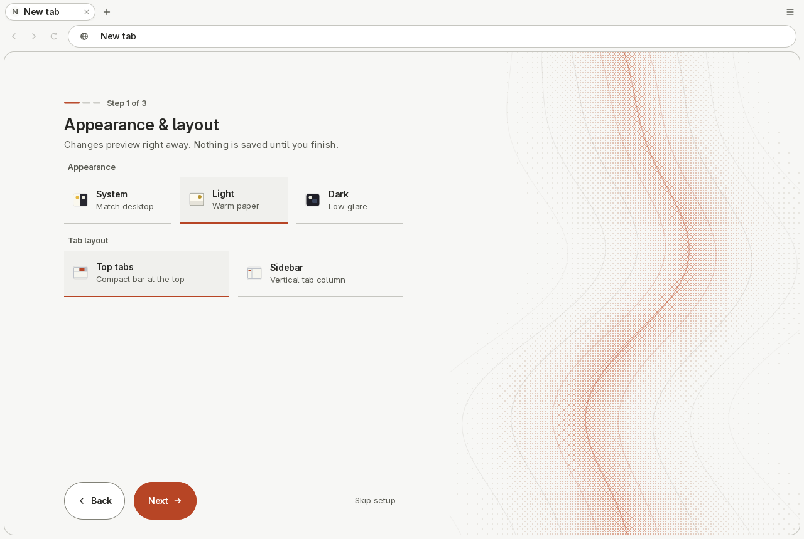
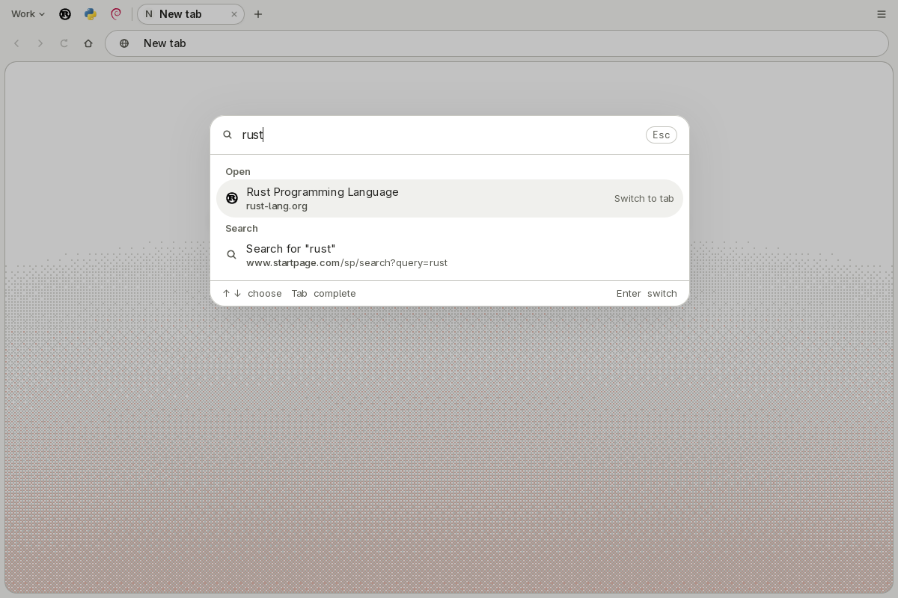
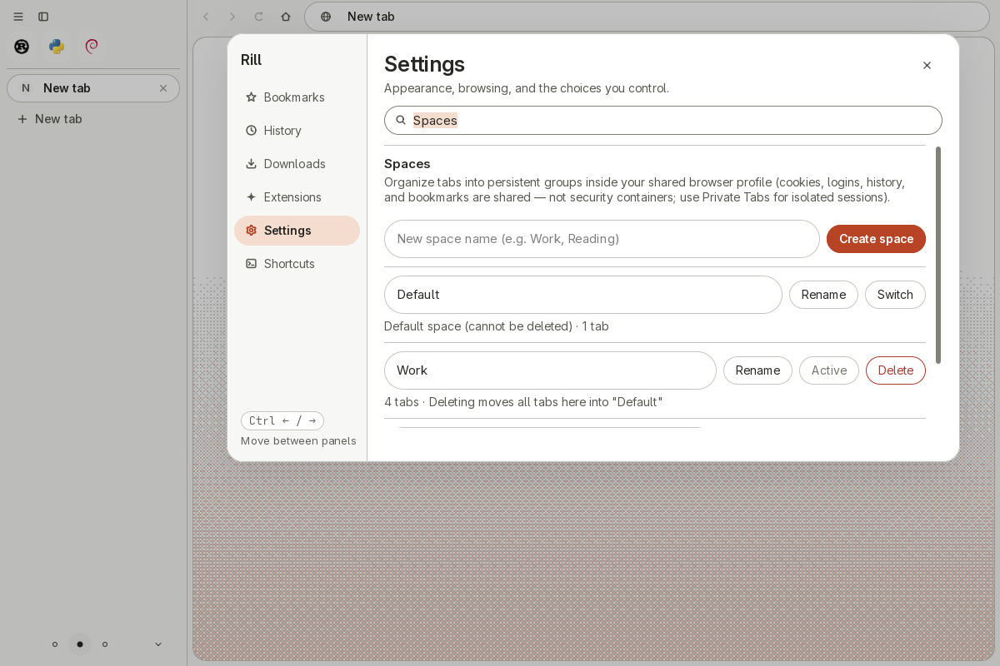
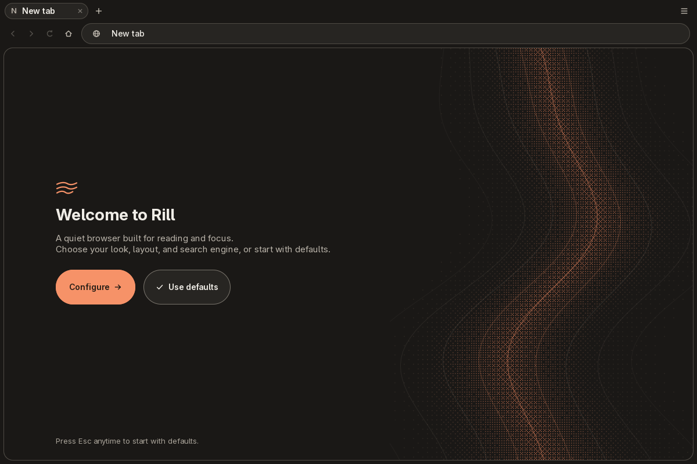

# Rill

A quiet, native browser for Linux. Fast where it matters, customizable where you want it, and calm by default.

Rill is built with Rust, GTK 3, and WebKitGTK 4.1. It is not Electron and does not bundle Chromium.


[Download Rill 1.1.0 for Linux (x86_64 AppImage)](https://github.com/INDAR-Beurre/search-linux/releases/download/v1.1.0/Rill-1.1.0-x86_64.AppImage) · [Release notes and checksum](https://github.com/INDAR-Beurre/search-linux/releases/tag/v1.1.0)

## A browser that adapts to you

**Two ways to work.** Use a familiar tab strip or switch to a vertical sidebar with `Ctrl S`. Pinned sites shrink to a compact icon rail. Drag tabs to reorder them.

**Spaces keep things separate.** Start with Default. Create a space for work, study, or anything else, then switch without losing your place. Each space remembers its own tabs and active page.

**Make the chrome yours.** Choose Minimal, Standard, or Full. Show or hide each toolbar button, reorder actions, adjust tab and sidebar widths, and switch between compact and roomy density. You can export your appearance and layout as JSON and import it on another machine.

**A start page without clutter.** Search or enter an address from one field. Add your own shortcuts, choose how they appear, and tune the dithered background from Off to Full.

**First run, your choice.** Step through a short setup with colored icons and live previews, or use the sensible defaults. Either way, Rill opens on a full tab — never a modal.

## Familiar tools, thoughtfully implemented

- **Omnibox** (`Ctrl L`) searches open tabs, bookmarks, history, keyword shortcuts, and optional engine suggestions, with clear HTTP/HTTPS indicators.
- **Reading mode** (`Ctrl Shift R`) presents articles in a clean, isolated view.
- **Peek** shows a link preview when you hold `Shift` before clicking.
- **Private tabs** (`Ctrl Shift N`) are strictly ephemeral and do not mix with regular history or bookmarks.
- **Site card** (`Ctrl I`) puts permissions, zoom, security, and site data in one place.
- **Content blocking** uses 15,775 bundled EasyList and EasyPrivacy rules.
- **Import** bookmarks and history from Firefox, Chromium, Chrome, Brave, Edge, and Vivaldi.
- **Tabs can sleep** after ten idle minutes, except when playing audio.

## Gallery

<table>
  <tr>
    <td width="50%"></td>
    <td width="50%"></td>
  </tr>
  <tr>
    <td><strong>Vertical tabs &amp; spaces</strong> — A calm sidebar with compact pins and a subtle space switcher.</td>
    <td><strong>Setup</strong> — Flat choices, colored icons, and immediate previews.</td>
  </tr>
  <tr>
    <td></td>
    <td></td>
  </tr>
  <tr>
    <td><strong>Omnibox</strong> — Find open tabs, bookmarks, and history as you type.</td>
    <td><strong>Manage spaces</strong> — Create, rename, switch, and delete spaces.</td>
  </tr>
  <tr>
    <td></td>
    <td></td>
  </tr>
  <tr>
    <td><strong>Search your way</strong> — Startpage, Ecosia, DuckDuckGo, Google, Bing, or Brave.</td>
    <td><strong>Privacy &amp; shortcuts</strong> — Choose live suggestions and optional starter sites.</td>
  </tr>
</table>

<details>
<summary>More screenshots</summary>




</details>

## Install

Rill 1.1.0 is a Linux x86_64 AppImage. Download it, verify the checksum, and run it:

```sh
sha256sum -c Rill-1.1.0-x86_64.AppImage.sha256
chmod +x Rill-1.1.0-x86_64.AppImage
./Rill-1.1.0-x86_64.AppImage
```

Open a URL directly:

```sh
./Rill-1.1.0-x86_64.AppImage --url https://example.com
```

The AppImage includes WebKitGTK, GTK helpers, fonts, and required media plugins. It needs Linux x86_64 and glibc 2.44 or newer. No installation or root access is required. On systems without FUSE, use `--appimage-extract-and-run`.

Rill uses the existing `search` XDG profile directories, so upgrading from earlier builds keeps your preferences, bookmarks, history, and onboarding state.

## Build from source

Requirements: current stable Rust (the locked `rusqlite` needs 1.89+), GTK 3, WebKitGTK 4.1, and GStreamer media plugins.

```sh
CARGO_TARGET_DIR=target/rill cargo build --release --bin search
./target/rill/release/search
```

The Cargo package and binary remain named `search` for profile and script compatibility.

## Keyboard shortcuts

| Navigation & tabs | Key | Page, panels & tools | Key |
|---|---|---|---|
| Address / search | `Ctrl L` | Find in page | `Ctrl F` |
| New tab / Private tab | `Ctrl T` / `Ctrl Shift N` | Reading mode | `Ctrl Shift R` |
| Close / Reopen tab | `Ctrl W` / `Ctrl Shift T` | Site card | `Ctrl I` |
| Back / Forward / Home | `Alt ←` / `Alt →` / `Alt Home` | Peek link preview | `Shift` + click |
| Switch tab / Move tab | `Ctrl Tab` / `Ctrl Shift PgUp/PgDn` | Bookmark page | `Ctrl D` |
| Toggle sidebar | `Ctrl S` | Bookmarks / History / Downloads | `Ctrl Shift B` / `Ctrl H` / `Ctrl J` |
| Hide navigation bar | `Ctrl Shift S` | Hide element / Restore hidden | `Ctrl Shift H` / `Ctrl Shift U` |
| Settings / All shortcuts | `Ctrl ,` / `Ctrl /` | Fullscreen / Dismiss overlay | `F11` / `Escape` |

## Good to know

- **Extensions have real limits.** WebKitGTK does not provide WebExtensions background workers, `chrome.*` messaging, blocking web requests, toolbar popups, or `nativeMessaging`. Password managers such as Bitwarden and 1Password do not work. See [docs/EXTENSIONS.md](docs/EXTENSIONS.md).
- **Video depends on system codecs.** Install `gst-plugins-good` and `gst-libav` for common H.264/VP9 playback.
- **Memory is honest.** The original ~100 MB total-PSS goal is not met; WebKitGTK has a higher floor. Historical measurements are in [docs/LIMITS.md](docs/LIMITS.md).
- **Desktop coverage.** Verified on X11 Openbox and headless Wayland Sway. KDE/KWin, Hyprland, and Omarchy have not been tested here.
- **Rill is not a Chromium clone.** It does not offer accounts, sync, passkeys, multi-window mode, DRM/EME, or certificate revocation checks.

## Documentation

- [Architecture](docs/ARCHITECTURE.md)
- [Extension support](docs/EXTENSIONS.md)
- [Testing and verification](docs/TESTING.md)
- [Packaging](packaging/README.md)

## Origin and license

Rill began as an independent Linux implementation of [Office Commun's Search](https://github.com/driceroland/Search), built from scratch in Rust with GTK 3 and WebKitGTK 4.1.

Licensed under [MIT](LICENSE).
