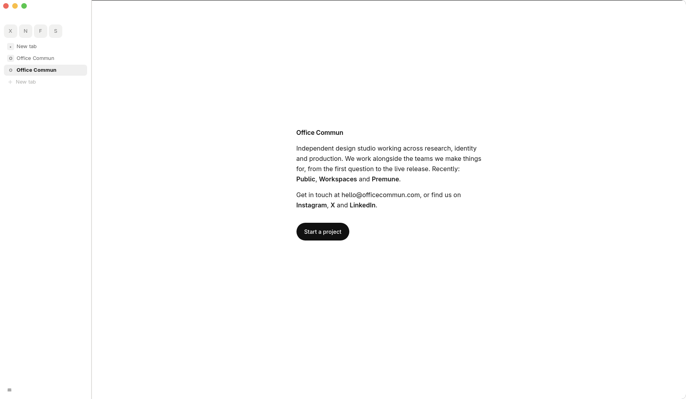

# Search

A small, fast, quiet web browser for Linux: a column of tabs and the page.
No toolbar, no start page, no account, no sidebar of suggestions.



Search was made for macOS by [Office Commun](https://officecommun.com) and is
open source at [driceroland/Search](https://github.com/driceroland/Search). This
is a Linux build of the same idea, written from scratch in Rust against the web
engine your desktop already ships — WebKitGTK — so there is no second copy of
Chromium to download, update and keep in memory.

* about 750 KB of binary
* one process for the frame, one for the page: ~100 MB of the browser's own
  memory with a tab open, measured, not estimated
* starts in under a second
* every page runs in WebKit's own process, as in Safari

## What it does

- **One field.** `Ctrl L` raises it over the page. Type an address and you go
  there; type words and you search. It suggests from your own history, your open
  tabs and your bookmarks, and sends nothing anywhere until you press Return.
- **Tabs that stay out of the way.** Tabs down the left, in a column that is
  yours to drag wider. Pin the pages you keep open all day and they shrink to a
  letter. Tabs from your last session come back, and cost nothing until you
  click one.
- **An ad and tracker blocker that runs before the page.** A WebKit content
  blocker compiled once at launch and enforced inside WebKit's own networking:
  nothing to render, nothing to pay for per frame. The rule list is a JSON file
  you can read and edit.
- **Hide anything, for good.** `Ctrl Shift H`, click a cookie banner, a
  newsletter overlay, a rail of "related" nonsense: it goes, and it is still
  gone on that site next time, before the page has drawn a single frame.
- **Reading mode.** `Ctrl Shift R` takes the article out of the page and sets it
  again in the browser's own type.
- **Find, downloads, bookmarks, history** — each a panel, each searchable, each
  one keystroke away.
- **Light, dark, or the desktop's own.** The frame and the pages follow.
- **A private tab** with its own cookie jar, gone when it closes.

## What it does not do

On purpose: no sync, no account, no cloud, no telemetry, no extension engine, no
second window. Tabs, history, bookmarks and what you have hidden are small JSON
files in your own folders and nowhere else.

## Build it

Needs GTK 3 and WebKitGTK 4.1 (package `webkit2gtk-4.1` on Arch, `libwebkit2gtk-4.1-dev`
on Debian and Ubuntu), Rust 1.75 or newer, and a running Wayland or X11 session.

```sh
cargo build --release
./target/release/search
```

That is the whole build. There is no bundler, no node, no submodule.

## Drive it, test it

```sh
python3 tools/fixtures.py 8099 &     # pages that are hard on a browser
cargo build --release
SEARCH_BENCH=1 ./target/release/search &
python3 tools/bench.py probe         # what the browser is showing
python3 tools/bench.py open https://example.com
python3 tools/bench.py text
python3 tools/stress.py              # the whole stress suite, ~4 minutes
```

`tools/stress.py` opens too many tabs, switches between them too fast, loads
pages that never finish, pages that eat memory, pages that redirect in a loop,
opens and closes every panel, hides things, uses find and reading mode, resizes
the window, and watches the memory the whole time. It writes
`build/stress-report.json` and exits non-zero if anything fails.

`tools/bench.py` speaks to a running browser over a Unix socket, one command per
line. It is the same idea as the Mac build's `./bench`.

## Keyboard

| | |
|---|---|
| `Ctrl L` field · `Ctrl T` new tab · `Ctrl W` close · `Ctrl Shift T` reopen | `Ctrl [ ]` back, forward · `Ctrl Tab` next, previous |
| `Ctrl 1`–`Ctrl 9` jump | `Ctrl R` reload · `Ctrl Shift R` reading mode |
| `Ctrl D` bookmark this page | `Ctrl F` find |
| `Ctrl Y` history · `Ctrl Shift B` bookmarks · `Ctrl J` downloads | `Ctrl ,` settings |
| `Ctrl Shift H` hide something · `Ctrl Shift U` what is hidden | `Ctrl Shift C` copy address |
| `Ctrl +` `Ctrl -` `Ctrl 0` zoom | `Ctrl Shift I` inspector |

## How it is put together

- **GTK 3** for the frame and the widgets, **WebKitGTK** for pages, **Rust**
  everywhere else. One module per concern in `src/`.
- `src/app.rs` is the browser: tabs, what is on screen, and every action a key,
  a click or a page can ask for. `src/web.rs` makes a page and tells the browser
  what the page is doing. `src/ui.rs` builds the widgets, `src/css.rs` and
  `src/palette.rs` make them look like this, `src/omnibox.rs`, `src/find.rs` and
  `src/panels.rs` are the things that come over the page.
- A tab's page is made when you first look at the tab. A tab restored from last
  session costs no process until you click it.
- The shield is a compiled content blocker. Hidden things are a user style sheet
  set before the document begins. Reading mode runs in the page, so it costs no
  second view and no third process.
- `src/bench.rs` is the socket tests drive the browser through; `tools/shots.sh`
  takes a picture of every state without needing a compositor.

## Licence

MIT. See [LICENSE](LICENSE).
