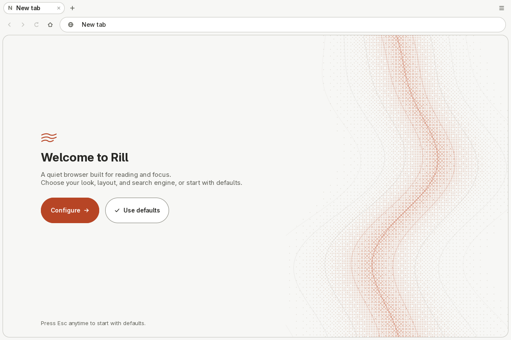
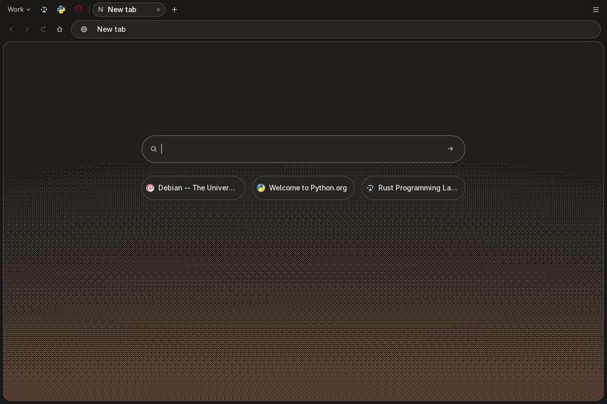

# Rill

A small, quiet, native WebKit browser for Linux written in Rust with GTK 3 and WebKitGTK 4.1.

No Electron, no bundled Chromium, and no account. Choose top tabs or a vertical sidebar, organize them into spaces, and keep the navigation controls you use. Rill uses your system's shared WebKitGTK engine.


*Unedited X11 capture of the current candidate (`1200×800`). The default **System** window-controls mode uses Openbox's native titlebar, outside the captured client area.*

> **Local preview build (unreleased).** The current candidate is `build/rill-spaces-f48`. No new GitHub release or Rill AppImage has been published; older `1.0.2` / `F39` AppImages in `build/` are historical artifacts from earlier builds.

## What Rill includes

- **Native GTK 3 interface**: Warm paper light mode and charcoal dark mode with terracotta accents, compact browser controls, rounded live viewport corners, and an 8×8 Bayer ordered-dither start page.
- **Mouse-first chrome you can trim down**: Switch between top tabs and a vertical sidebar (`Ctrl S`), with one tab rail visible at a time, favicon-only pins, and pointer drag-reorder. Back/Forward/Reload/Stop/Home, inline menu zoom, and individual toolbar toggles stay within reach.
- **Spaces for different tasks**: Start with Default; create, rename, or delete additional spaces in Settings. Each space remembers its tabs and selection. Deleting a space moves its tabs to Default. Spaces share cookies, bookmarks, and history; they are not isolated containers.
- **Full-tab first-run setup**: Use defaults immediately or choose appearance, tab layout, search engine, live suggestions, and optional starter shortcuts. Setup appears only until completed or skipped.
- **Appearance and layout controls**: Minimal, Standard, and Full presets; independent toolbar buttons and ordering; adjustable tab and sidebar widths; compact or roomy density; and validated appearance/layout JSON import and export. Fresh profiles use Minimal.
- **Customizable start page**: Direct search/URL input, optional bookmark shortcuts with a configurable count and display style, and Off/Subtle/Full background dither. Cached real site favicons identify your bookmarks.
- **Fast omnibox (`Ctrl L`)**: Searches open tabs, bookmarks, history, keyword shortcuts, and optional live search-engine suggestions (Startpage default; Ecosia, DuckDuckGo, Google, Bing, and Brave supported) with honest TLS/HTTP security chips.
- **Engine-level blocking & privacy**: **15,775** compiled EasyList + EasyPrivacy rules enforced inside WebKitGTK, persistent per-site element hiding (`Ctrl Shift H`) in an isolated script world, and strictly ephemeral private tabs (`Ctrl Shift N`) that hide regular bookmarks and history.
- **Built for daily reading**: Sanitized isolated-world Reading Mode (`Ctrl Shift R`), `Shift` + click floating Peek link cards, `Ctrl I` site security/permissions/zoom/data card, per-tab sleep after 10 idle minutes (exempting audio), and bookmark/history import from Firefox, Chromium, Chrome, Brave, Edge, and Vivaldi.

## Screenshots

These images in `docs/screenshots/rill-f48/` are unedited external X11 captures of `build/rill-spaces-f48`. Site icons were cached while visiting the real Rust, Python, and Debian websites. Generated design concepts are kept outside the product gallery.

<table>
  <tr>
    <td width="50%"></td>
    <td width="50%"></td>
  </tr>
  <tr>
    <td><strong>First run</strong> — A full-tab introduction with immediate defaults or optional setup.</td>
    <td><strong>Vertical tabs &amp; spaces</strong> — Compact favicon pins above the current space's tabs, with no duplicate top strip.</td>
  </tr>
  <tr>
    <td></td>
    <td></td>
  </tr>
  <tr>
    <td><strong>Omnibox (<code>Ctrl L</code>)</strong> — Local tab completion with a cached favicon; optional engine suggestions are disabled in this capture.</td>
    <td><strong>Manage spaces</strong> — Create, rename, switch, and delete groups in Settings. Default cannot be deleted.</td>
  </tr>
</table>

Setup uses flat choices with colored icons and an understated selection rule. Theme and tab layout preview immediately; skipping setup reverts the preview.

<table>
  <tr>
    <td width="50%"></td>
    <td width="50%"></td>
  </tr>
</table>

<details>
<summary>More screenshots: dark introduction, top tabs, and compact icons-only shortcuts</summary>
<br>
<table>
  <tr>
    <td width="50%"></td>
    <td width="50%"></td>
  </tr>
  <tr>
    <td><strong>Dark introduction</strong> — The same full-tab setup with dark chrome.</td>
    <td><strong>Top tabs</strong> — Choose the horizontal layout and keep pins as compact icons.</td>
  </tr>
</table>


*900px layout with icons-only homepage shortcuts; full titles and addresses remain available in tooltips and accessible names.*

</details>

## Run locally or build from source

### Requirements

- **Current stable Rust** (the locked `rusqlite` dependency requires at least Rust 1.89)
- **GTK 3** and **WebKitGTK 4.1** (`webkit2gtk-4.1` on Arch, `libwebkit2gtk-4.1-dev` on Debian/Ubuntu)
- **GStreamer media plugins**: `gst-plugins-good` supplies audio output, VP9, and common containers; `gst-libav` adds H.264 decoding on Arch/Artix. Debian/Ubuntu equivalents are `gstreamer1.0-plugins-good` and `gstreamer1.0-libav`. Actual codec support depends on the installed plugins.
- An X11 or Wayland desktop session

### Build from source

The Cargo crate and binary target keep their legacy internal name `search` for profile and script compatibility. Building into a dedicated target directory avoids touching any archived release binary:

```sh
CARGO_TARGET_DIR=target/rill cargo build --release --bin search
./target/rill/release/search
```

If you already have the local preview binary built in this workspace:

```sh
./build/rill-spaces-f48
```

### Internal names & profile compatibility

Rill preserves existing profile directories and environment variables so upgrading from earlier `search` builds keeps all preferences, bookmarks, history, and onboarding state without migration:

- **Config / Data / Cache**: `$XDG_CONFIG_HOME/search`, `$XDG_DATA_HOME/search`, `$XDG_CACHE_HOME/search`
- **Environment variables**: `SEARCH_LOW_MEMORY`, `SEARCH_ENABLE_DMABUF`, `SEARCH_BENCH`, `SEARCH_BINARY`, etc.
- **Window identity**: Display title is `Rill`; `WM_CLASS` stays `search` to match the desktop entry and avoid duplicate taskbar icons.

<details>
<summary>Install a local desktop launcher</summary>

Copy the binary onto your `PATH` (for example `~/.local/bin/search`) and install the desktop file from [`packaging/Search.desktop`](packaging/Search.desktop):

```sh
install -Dm755 target/rill/release/search ~/.local/bin/search
install -Dm644 packaging/Search.desktop ~/.local/share/applications/Search.desktop
install -Dm644 packaging/search.png ~/.local/share/icons/hicolor/512x512/apps/search.png
```

`packaging/Search.desktop` sets `Name=Rill`, `StartupWMClass=search`, and `Exec=search --url %u` so clicking HTTP/HTTPS links opens them directly. See [packaging/README.md](packaging/README.md) for AppImage build instructions and historic release notes.

</details>

## Keyboard shortcuts

| Navigation & Tabs | Key | Page, Panels & Tools | Key |
|---|---|---|---|
| Address / search field | `Ctrl L` | Find in page | `Ctrl F` |
| New tab / Private tab | `Ctrl T` / `Ctrl Shift N` | Reading mode | `Ctrl Shift R` |
| Close / Reopen tab | `Ctrl W` / `Ctrl Shift T` | Site info, zoom & permissions | `Ctrl I` |
| Back / Forward / Home | `Alt ←` / `Alt →` / `Alt Home` | Peek link in floating card | `Shift` + click |
| Switch tab / Move tab | `Ctrl Tab` / `Ctrl Shift PgUp/PgDn` | Bookmark page | `Ctrl D` |
| Toggle tab sidebar | `Ctrl S` | Bookmarks / History / Downloads | `Ctrl Shift B` / `Ctrl H` / `Ctrl J` |
| Show / hide navigation bar | `Ctrl Shift S` | Hide element / Restore hidden | `Ctrl Shift H` / `Ctrl Shift U` |
| Settings / All shortcuts | `Ctrl ,` / `Ctrl /` | Fullscreen / Dismiss overlay | `F11` / `Escape` |

## Honest limits

- **Extensions & add-ons**: Rill is **not** a full WebExtensions browser. WebKitGTK has no background service workers, `chrome.*`/`browser.*` storage or messaging APIs, `webRequestBlocking`, toolbar popups, or `nativeMessaging`. Only content scripts, CSS, and `options_ui` can execute. Password-manager extensions (**Bitwarden**, **1Password**, **KeePassXC-Browser**) and built-in autofill do **not** work here. The F47 audit of **110 real SHA-verified AMO `.xpi` packages** (distinct from 108 synthetic loader fixtures) found **4** installer rejections and **106** installations with local-page smoke only (**22** unsupported, **83** partial, **1** content-capable — not 106 functioning products). In-app AMO search is HTTPS-bounded and user-initiated; compatibility badges estimate capability and are not certified support. See [docs/EXTENSIONS.md](docs/EXTENSIONS.md).
- **Memory**: The original **~100 MB total-PSS target is unmet**. No new memory total is claimed for this build; the last archived full stress measurement (historical Design F39, `docs/benchmarks/stress-report-f39.json`) recorded **182.9 MB warm total PSS** (**94.5 MB** own anonymous PSS, **441.9 MB** RSS across 3 processes) for one idle tab against WebKitGTK's 230 MB floor. See [docs/LIMITS.md](docs/LIMITS.md).
- **Linux desktop coverage**: Window decoration negotiation (`System` / `Browser` / `Hidden` in Settings) has been runtime-verified on **X11 Openbox** and **headless Wayland Sway**. KDE/KWin, Hyprland, and Omarchy were not installed in this environment and are not claimed runtime-verified.
- **Out of scope**: No accounts or cloud sync, no built-in password manager or passkeys, no multi-window mode, no DRM/EME playback, no cross-app picture-in-picture, and no certificate revocation checks (OCSP/CRL).

## Documentation

- [docs/ARCHITECTURE.md](docs/ARCHITECTURE.md) — Rust module map, WebKitGTK integration, and frame layout
- [docs/EXTENSIONS.md](docs/EXTENSIONS.md) — Add-on capabilities, AMO catalog guards, and the 110 real-package test report
- [docs/LIMITS.md](docs/LIMITS.md) — Detailed technical limits and archived memory/stress figures
- [docs/DIFFERENCES.md](docs/DIFFERENCES.md) — How Rill differs from macOS Search
- [docs/TESTING.md](docs/TESTING.md) — Unit tests, GTK UI walkthrough, bench socket, and stress harnesses
- [packaging/README.md](packaging/README.md) — AppImage build preflight, font/plugin licenses, and historical artifacts

## Origin and license

Rill began as an independent Linux implementation of [Office Commun's Search](https://github.com/driceroland/Search) ([officecommun.com](https://officecommun.com)), built from scratch in Rust with GTK 3 and WebKitGTK 4.1.

Licensed under [MIT](LICENSE). See [CONTRIBUTING.md](CONTRIBUTING.md) and [CHANGELOG.md](CHANGELOG.md).
