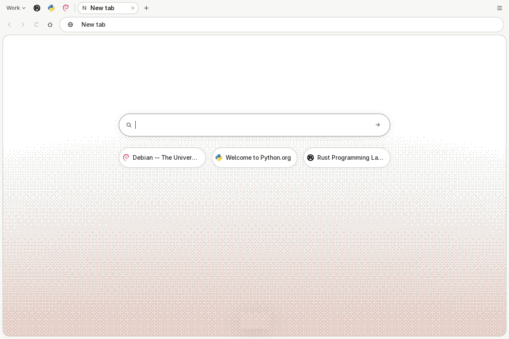
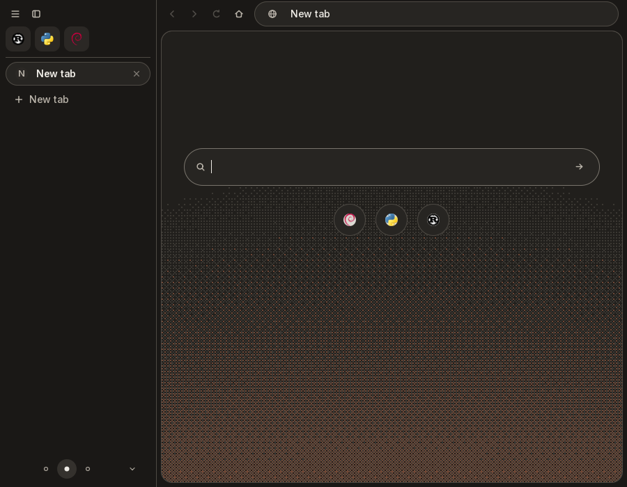

# Rill

A small, quiet, native web browser for Linux built with Rust, GTK 3, and WebKitGTK 4.1.

Rill draws its own native window chrome and relies on WebKitGTK instead of bundling Chromium or Electron. There is no account prompt, no telemetry, no built-in password vault, and no modal onboarding wizard blocking the window. Open it, browse, and adjust the layout only if you want to.



[GitHub Releases (v1.1.0)](https://github.com/INDAR-Beurre/Rill/releases) · [v1.1.0 Release Tag](https://github.com/INDAR-Beurre/Rill/releases/tag/v1.1.0) · [Limitations & Numbers](docs/LIMITS.md) · [Extension Support](docs/EXTENSIONS.md) · [Packaging Guide](packaging/README.md)

## Release status: 1.1.0 vs. unreleased 1.2 work

**Current shipped release: `1.1.0`** (`Cargo.toml` is still `version = "1.1.0"`).

- **Publicly published today:** Only the frozen `v1.1.0` AppImage (`Rill-1.1.0-x86_64.AppImage`, built on Artix Linux against glibc 2.44) is published on [GitHub Releases](https://github.com/INDAR-Beurre/Rill/releases/tag/v1.1.0). Because that frozen 1.1.0 build bundled host glibc/loader libraries and targets glibc 2.44, it fails to launch on glibc < 2.44 systems such as Debian 12, Ubuntu 24.04, Fedora 43, and EL9.
- **Current development state:** Wave A 1.2 features are implemented and test-backed (`T01`–`T45`, `T47`–`T50`; `T46` was already present in 1.1 and was not counted). Wave B `L01`–`L08` are integration-accepted only. `L09`–`L50` remain deferred until reviewed and verified. None of this work is a shipped or supported release claim.
- **Unreleased 1.2 work in progress:** Native packaging recipes (`.deb`, `.rpm`, Arch `PKGBUILD`, portable `.tar.gz`), the glibc 2.36-floor AppImage builder fixes, and the next-release browser feature work exist in this repository as **unreleased candidate work** — **Rill 1.2 has not been tagged or published**. No prebuilt 1.2 downloads exist yet.
- **Compatibility testing evidence below** was measured on frozen `1.1.0` source revision `35b9a62` packaged into local glibc 2.36 compatibility candidates (`Rill-1.1.0-x86_64-glibc2.36-r2.AppImage`, `rill_1.1.0-1_amd64.deb`, and an Arch package), **not** an unreleased 1.2 build.

---

## Install and run

Choose the path that matches your system today:

### Build from source

*Recommended today for Debian, Ubuntu, Fedora, openSUSE, Arch, and any glibc < 2.44 desktop.*

Because the currently published `v1.1.0` AppImage requires glibc 2.44+, building from source or building a local native package is the reliable way to run Rill on Debian 12+, Ubuntu 24.04+, Linux Mint 22+, Fedora 38+, openSUSE Leap 15.6 / Tumbleweed, or Arch-family systems until a glibc 2.36+ release is published.

**Requirements:**
- Rust **1.89+** (required by the locked `rusqlite` crate)
- GTK 3 (`gtk+-3.0`), WebKitGTK **4.1** (`webkit2gtk-4.1 >= 2.40`), `libsoup3` (`libsoup-3.0`), SQLite 3 (`sqlite3`)
- GStreamer plugins: `gst-plugins-base` and **`gst-plugins-good`** (required at runtime for `autoaudiosink`; without `gst-plugins-good`, WebKit's page process crashes on sites that initialize audio, including GitHub). Install `gst-libav` for common H.264/VP9 playback.

```sh
git clone https://github.com/INDAR-Beurre/Rill.git
cd Rill
CARGO_TARGET_DIR=target/rill cargo build --release --bin search
./target/rill/release/search
```

Open a URL directly:

```sh
./target/rill/release/search --url https://example.com
```

The Cargo package and compiled binary remain named `search` (with `rill` used as the user-facing symlink in native packages) so existing profiles, desktop files, and scripts keep working without migration.

### Published v1.1.0 AppImage (glibc 2.44+ rolling distros only)

The currently published release artifact is `Rill-1.1.0-x86_64.AppImage` on the [v1.1.0 release page](https://github.com/INDAR-Beurre/Rill/releases/tag/v1.1.0). Download both the AppImage and its `.sha256` sidecar into the same directory:

```sh
sha256sum -c Rill-1.1.0-x86_64.AppImage.sha256
chmod +x Rill-1.1.0-x86_64.AppImage
./Rill-1.1.0-x86_64.AppImage
```

On systems without FUSE, run:

```sh
./Rill-1.1.0-x86_64.AppImage --appimage-extract-and-run
```

**Important caveat for the published 1.1.0 AppImage:** It requires Linux `x86_64` with **glibc 2.44 or newer** (for example current Arch/Artix/openSUSE Tumbleweed). On older glibc systems it exits immediately with `symbol lookup error: .../libc.so.6: undefined symbol: __pointer_chk_guard, version GLIBC_PRIVATE`. See [packaging/README.md](packaging/README.md) (`VM-001`) for the root cause.

### Local candidate native packages & glibc 2.36 AppImage

This repository contains working packaging recipes for `.deb`, `.rpm`, Arch `.pkg.tar.zst`, portable `.tar.gz`, and a hardened AppImage builder (`tools/appimage.sh`). These are **local build recipes**, not published release downloads yet — there are no prebuilt `/releases/latest/download/...` URLs for `.deb`, `.rpm`, `.pkg.tar.zst`, or `.tar.gz`.

| Format | Build script (run on matching target OS) | Target floor / notes |
| --- | --- | --- |
| Debian / Ubuntu `.deb` | `tools/package-deb.sh` | Debian 12+ (`bookworm`), Ubuntu 24.04+, Mint 22+, Kali, Zorin, KDE neon (supports pre- and post-`t64` library names) |
| Fedora / openSUSE `.rpm` | `tools/package-rpm.sh` | Fedora 38+, openSUSE Leap 15.6 / Tumbleweed, EL10+ (requires `webkit2gtk-4.1` + `libsoup3`; **not EL9**) |
| Arch-family `.pkg.tar.zst` | `tools/package-arch.sh` | Arch, Artix, CachyOS, EndeavourOS via isolated `makepkg` |
| Portable `.tar.gz` | `tools/package-tarball.sh` | Per-user `~/.local` or `/usr/local` with `install.sh` / `uninstall.sh` |
| Portable `.AppImage` | `MAX_GLIBC=2.36 tools/appimage.sh` | Build inside Debian 12 to target glibc 2.36+ without bundling host `libc.so.6`, `ld-linux`, or Mesa DRI drivers |

Full build, install, uninstall, and offline ABI verification instructions (`python3 tools/package_test.py`) live in [packaging/README.md](packaging/README.md).

---

## Runtime dependencies & platform caveats

- **WebKitGTK 4.1 + libsoup 3 floor:** Rill compiles against `webkit2gtk-4.1` (`>= 2.40`) and `libsoup-3.0`. Enterprise Linux 9 distributions (**AlmaLinux 9, Rocky Linux 9, Oracle Linux 9, CentOS Stream 9**) ship glibc 2.34 and only `webkit2gtk-4.0` (`libsoup 2.4`) across default, CRB, and EPEL repositories, so neither the glibc 2.36 AppImage nor a native `.rpm` runs on EL9.
- **Minimal desktop/cloud images:** Even with the glibc 2.36 candidate AppImage, minimal systems without audio, Mesa/GBM, or D-Bus session tooling can still fail before the window opens:
  - Missing `libasound.so.2` (`alsa-lib` / `libasound2t64`) blocked the candidate AppImage (`r2`) on minimal Ubuntu 24.04.5 and Arch VMs until installed. The updated `tools/appimage.sh` now bundles `libasound.so.2` for future builds.
  - Missing host Mesa/EGL/GBM (`libgbm.so.1`, `swrast`) blocked launch on minimal openEuler 24.03 until installed (graphics drivers are deliberately never bundled in the AppImage).
  - On current openSUSE Tumbleweed, `dbus-1-daemon` (not just `dbus-1-tools`) is required for `/usr/bin/dbus-run-session`.
- **Non-FHS & musl systems:** NixOS lacks the standard `/lib64/ld-linux-x86-64.so.2` dynamic linker path expected by generic AppImages (running an AppImage on NixOS requires `appimage-run` or a native Nix derivation, neither of which was tested in the VM matrix). Alpine Linux uses musl rather than glibc.
- **GStreamer audio/video plugins:** Native/source builds need `gst-plugins-good` (`autoaudiosink`) to avoid page-process crashes on sites that initialize WebAudio/media (such as GitHub), plus `gst-libav` for H.264/VP9 video. AV1 (`dav1d`) has not been verified.
- **Desktop coverage:** Real-input and walkthrough verification covers X11 (`Xvfb` + Openbox) and headless Wayland (`sway` via bench socket). KDE/KWin, Hyprland, GNOME Wayland hardware smoothness, and Omarchy are not verified.

---

## Feature tour (shipped in 1.1.0)

### Quiet chrome, exclusive tab layouts, and Spaces

- **Top tabs or vertical sidebar (`Ctrl S`):** Switch cleanly between a traditional horizontal tab strip and a vertical sidebar. Layouts are strictly exclusive (never duplicated) and persist across restarts, fullscreen, and hidden navigation bars (`Ctrl Shift S`).
- **Pinned sites:** Collapse to a compact favicon rail that stays readable at narrow widths. Tabs and pins can be reordered by drag-and-drop or keyboard.
- **Spaces:** Start with `Default`, and create named spaces for work, research, or personal tabs. Each space tracks its own tabs and active page. *Privacy note:* Spaces organize tabs; they share cookies, history, and bookmarks and are **not** isolated browser profiles.
- **Full-tab first-run setup:** On a fresh profile, onboarding opens inside the tab rather than as a modal overlay, offering live previews of light/dark/system theme, top tabs vs. sidebar, search engine choice, live search suggestions toggle, and optional starter shortcuts — or a single click on `Use defaults`.
- **Deep customization in Settings (`Ctrl ,`):** Start from `Minimal`, `Standard`, or `Full` presets, then show/hide and reorder toolbar buttons, adjust tab and sidebar widths, pick compact or roomy density, toggle homepage shortcuts and background dither, or export/import appearance and layout settings as a small JSON file.

### Everyday browsing tools

- **Omnibox (`Ctrl L`):** Searches open tabs, bookmarks, history, keyword shortcuts, and optional live search suggestions with clear HTTP/HTTPS status indicators.
- **Reading mode (`Ctrl Shift R`):** Extracts article text into a clean reader view with adjustable typography.
- **Peek (`Shift` + click):** Preview any link in an in-tab floating card without leaving the current page (`Escape` dismisses it).
- **Private tabs (`Ctrl Shift N`):** Backed by WebKit's ephemeral data manager — no cookies, site storage, regular history, or bookmarks are written to disk, and private tabs are excluded from Spaces persistence and search suggestions.
- **Site card (`Ctrl I`):** Inspect TLS status, site permissions (notifications, location, camera, microphone, clipboard), zoom level, and site data in one popover.
- **Built-in content blocker:** 15,775 compiled EasyList and EasyPrivacy rules (`network.json`, `hide-0.json`, `hide-sites.json`) enforced natively by WebKitGTK's content-filter engine, with a per-site toggle.
- **Per-site element hiding (`Ctrl Shift H` / `Ctrl Shift U`):** Persistently hide unwanted page elements per host in an isolated WebKit script world.
- **Sleeping tabs:** Background tabs release their WebKit view after 10 idle minutes while keeping their title and URL. Tabs playing audio are automatically exempt.
- **6-browser importer:** Background-threaded import of bookmarks and history (up to 4,000 HTTP/HTTPS entries, additive only) from Firefox, Chromium, Chrome, Brave, Edge, and Vivaldi.
- **Honest add-on discovery:** User-initiated HTTPS search against `addons.mozilla.org` with strict host/redirect/size caps and explicit capability warnings (see [Known limitations](#known-limitations) below).

## Gallery

<table>
  <tr>
    <td width="50%"></td>
    <td width="50%"></td>
  </tr>
  <tr>
    <td><strong>Vertical tabs &amp; spaces</strong> — A quiet sidebar with compact pins and a subtle space switcher.</td>
    <td><strong>Setup</strong> — Flat choices, colored icons, and immediate previews.</td>
  </tr>
  <tr>
    <td></td>
    <td></td>
  </tr>
  <tr>
    <td><strong>Omnibox</strong> — Find open tabs, bookmarks, and history as you type.</td>
    <td><strong>Manage spaces</strong> — Create, rename, switch, and delete spaces.</td>
  </tr>
  <tr>
    <td></td>
    <td></td>
  </tr>
  <tr>
    <td><strong>Search your way</strong> — Startpage, Ecosia, DuckDuckGo, Google, Bing, or Brave.</td>
    <td><strong>Privacy &amp; shortcuts</strong> — Choose live suggestions and optional starter sites.</td>
  </tr>
</table>

<details>
<summary>More screenshots</summary>




</details>

### Keyboard shortcuts

| Navigation & tabs | Key | Page, panels & tools | Key |
| --- | --- | --- | --- |
| Address / search | `Ctrl L` | Find in page | `Ctrl F` |
| New tab / Private tab | `Ctrl T` / `Ctrl Shift N` | Reading mode | `Ctrl Shift R` |
| Close / Reopen tab | `Ctrl W` / `Ctrl Shift T` | Site card | `Ctrl I` |
| Back / Forward / Home | `Alt ←` / `Alt →` / `Alt Home` | Peek link preview | `Shift` + click |
| Switch tab / Move tab | `Ctrl Tab` / `Ctrl Shift PgUp/PgDn` | Bookmark page | `Ctrl D` |
| Toggle sidebar | `Ctrl S` | Bookmarks / History / Downloads | `Ctrl Shift B` / `Ctrl H` / `Ctrl J` |
| Hide navigation bar | `Ctrl Shift S` | Hide element / Restore hidden | `Ctrl Shift H` / `Ctrl Shift U` |
| Settings / All shortcuts | `Ctrl ,` / `Ctrl /` | Fullscreen / Dismiss overlay | `F11` / `Escape` |

---

## Privacy & profile compatibility

### Stable profile paths (`~/.config/search`)

Rill intentionally preserves its original XDG profile directories across source builds, AppImages, and every native package format:

- `$XDG_CONFIG_HOME/search` (default `~/.config/search`) — preferences, spaces, bookmarks, toolbar/layout config
- `$XDG_DATA_HOME/search` (default `~/.local/share/search`) — cookies (`cookies.sqlite`), site storage, HSTS, history, downloads, installed extensions
- `$XDG_CACHE_HOME/search` (default `~/.cache/search`) — WebKit caches and favicons

This stability is deliberate: upgrading from earlier Search/Rill builds or switching between an AppImage and a native package keeps your settings, bookmarks, and history intact. Uninstalling any native package never deletes your profile directories.

### What stays private (and what connects to the network)

- **No background telemetry or accounts.** Opening Rill or opening the Add-ons panel makes zero network requests until you navigate, type a query with suggestions enabled, or explicitly search/install from AMO.
- **Search suggestions (opt-out):** Enabled by default on fresh profiles for plain search queries (HTTPS only to your chosen engine: Startpage default, Ecosia, DuckDuckGo, Google, Bing, or Brave) after a 120 ms pause, with a 1.0 s timeout. Never sent from private tabs, keyword shortcuts, `Ctrl K`, or text that looks like a URL, path, email, key, card number, or exceeds 80 characters. Turn off anytime in Settings.
- **Credentials:** Rill has no password store and never saves HTTP auth or form passwords.
- **Permissions:** Notifications, geolocation, camera, microphone, and clipboard read requests use Rill's own Allow/Block card (remembered per site in normal tabs; asked every time in private tabs; denied silently for background tabs). Device info, DRM/EME media keys, pointer lock, website data access, and WebXR are refused automatically.
- **TLS errors:** Expired, not-yet-valid, wrong-host, and untrusted-root certificates block the page with no bypass button. *Caveat:* WebKitGTK does not perform online certificate revocation checks (OCSP/CRL).

---

## Memory: methodology & measured process-tree PSS

Browser memory numbers are easy to cherry-pick, so Rill reports whole-tree measurements and keeps the methodology explicit.

### How we measure

- **Total PSS (`pss_mb` / `total_pss_mib`):** Proportional Set Size summed across Rill's entire process tree (shared GTK/WebKit libraries divided proportionally among processes mapping them). This is the fairest single number for real memory footprint.
- **Own / anonymous PSS (`Pss_Anon`):** Private/anonymous memory attributable to Rill and its WebKit processes, excluding shared library file mappings. Useful diagnostically, never a substitute for total PSS.
- **Summed RSS (`rss_mb`):** Resident Set Size summed across every process. Double-counts shared libraries across processes, so it looks much larger than actual RAM consumed.
- **Process-tree scoping:** `tools/stress.py` sums over Rill's dedicated process group (catching reparented WebKit helpers). The VM guest smoke harness (`guest_smoke.py`) walks the launched browser PID and its live descendants (`search`, `WebKitWebProcess`, `WebKitNetworkProcess`, plus the AppImage runtime wrapper when running an AppImage) and marks a measurement `complete: true` only when every process in the tree was readable.
- **Why the original ~100 MB total-PSS goal remains unmet:** On Linux/WebKitGTK 4.1, shared GTK/WebKit file mappings alone take ~78 MB of PSS across 3 processes before any page allocates anonymous heap. The ~100 MB target came from mistaking anonymous memory for total PSS. `tools/stress.py` enforces a practical **230 MB WebKitGTK floor** for one idle local tab on the native source host, while keeping the original 100 MB goal explicitly marked unmet in [docs/LIMITS.md](docs/LIMITS.md).

### Measured source-host stress runs (1.1.0 / pre-1.1.0 baselines)

These runs were executed on the Artix Linux development host under X11 (`Xvfb` + Openbox) against local fixture pages served by `tools/fixtures.py`. They are **1.1.0 / F39–F49 baseline measurements**, not 1.2 measurements.

| Run & artifact | Test condition | Total PSS | Own (`Pss_Anon`) | Summed RSS | Processes | Source report |
| --- | --- | ---: | ---: | ---: | ---: | --- |
| **F49 quick stress** (`build/rill-spaces-f48`, SHA `2aaa8c13…`, prior-hash 1.1.0 candidate; 158/158 passed) | 1 idle local tab (warm) | **151.1 MB** | **92.3 MB** | — | 3 | [docs/benchmarks/f49-verification.json](docs/benchmarks/f49-verification.json) |
| **Archived F39 full stress** (151/151 passed) | 1 idle local tab (warm / cold) | **182.9 MB** (185.3 MB cold) | **94.5 MB** | 441.9 MB | 3 (`search` 81.4, `WebProcess` 71.2, `NetworkProcess` 30.2 MB) | [docs/benchmarks/stress-report-f39.json](docs/benchmarks/stress-report-f39.json) |
| **Archived F39 full stress** | 21 local tabs open (+20.4 MB/tab) | **598.0 MB** | **468.1 MB** | 2,616.8 MB | 23 | [docs/benchmarks/stress-report-f39.json](docs/benchmarks/stress-report-f39.json) |
| **Archived F39 full stress** | After closing 20 tabs (back to 1 tab) | **186.0 MB** | **93.0 MB** | 447.2 MB | 3 | [docs/benchmarks/stress-report-f39.json](docs/benchmarks/stress-report-f39.json) |
| **Archived F39 full stress** | Tab sleep (1 idle tab releases view) | **209.8 → 169.2 MB** (-40.6 MB) | **120.9 → 84.5 MB** (-36.4 MB) | 545.9 → 421.3 MB | 3 | [docs/benchmarks/stress-report-f39.json](docs/benchmarks/stress-report-f39.json) |
| **Archived F39 full stress** | Memory-spray survival peak → settled | **1,295.6 → 416.5 MB** | **1,143.6 → 274.6 MB** | 2,200.8 → 1,213.1 MB | 10 → 9 | [docs/benchmarks/stress-report-f39.json](docs/benchmarks/stress-report-f39.json) |

### Measured QEMU-KVM guest process-tree PSS (1.1.0 glibc 2.36 compatibility candidates)

Measured inside fresh **QEMU-KVM virtual machines** (2 vCPU, 2 GiB RAM, `Xvfb` + Openbox X11 session, single idle local HTML fixture page) on frozen `1.1.0` source revision `35b9a621`:
- **Candidate AppImage:** `Rill-1.1.0-x86_64-glibc2.36-r2.AppImage` (`sha256: 2796564e…`) — 4 processes (includes the AppImage extract/runtime wrapper)
- **Candidate native `.deb`:** `rill_1.1.0-1_amd64.deb` (`sha256: f5954b61…`) — 3 processes
- All rows below had `complete: true` (zero unreadable PIDs). These are **idle local-page readings on 1.1.0 compatibility candidates**, not a budget for heavy JS web apps or 1.2 builds.

| KVM Guest | AppImage Total PSS | Native Package Total PSS | Measurement Condition |
| --- | ---: | ---: | --- |
| **Debian 12** (`bookworm`) | **228.0 MiB** (407.5 MiB RSS) | **232.4 MiB** (`.deb`) | Clean AppImage + native `.deb` |
| **Ubuntu 24.04.5 LTS** | **219.6 MiB** *(after deps)* | **184.8 MiB** (`.deb`) | AppImage needed `libasound.so.2` first |
| **Kali 2026.3** | **274.3 MiB** | **251.7 MiB** (`.deb`) | Clean AppImage + native `.deb` |
| **Linux Mint 22.3** | **261.5 MiB** | **210.9 MiB** (`.deb`) | Clean AppImage + native `.deb` *(desktop launcher bug separate)* |
| **KDE neon** | **229.8 MiB** | **207.0 MiB** (`.deb`) | Clean AppImage + native `.deb` |
| **Zorin OS 18.1** | **252.0 MiB** | **194.8 MiB** (`.deb`) | Clean AppImage + native `.deb` |
| **openEuler 24.03 LTS SP2** | **229.2 MiB** *(after deps)* | — *(RPM distro)* | AppImage needed Mesa/ALSA/EGL/swrast first |
| **Arch Linux** | **229.5 MiB** (388.4 MiB RSS) *(after deps)* | *(13/13 pass on native pkg)* | AppImage needed `alsa-lib` (`libasound.so.2`) first |
| **Fedora 43** | **230.3 MiB** (394.4 MiB RSS) *(after deps)* | — | Cloud image after GUI/runtime deps |
| **openSUSE Tumbleweed** | **272.6 MiB** (428.9 MiB RSS) *(after deps)* | — | Minimal VM after GUI/runtime deps + `dbus-1-daemon` |
| **Artix Linux (host)** | **228.3 MiB** (incl. 25.5 MiB AppImage wrapper) | — | Non-systemd host smoke (`13/13`, 4 processes) |

*(Memory knobs: `WEBKIT_DISABLE_DMABUF_RENDERER=1` and `MALLOC_ARENA_MAX=2` are active by default; **Settings → Use less memory** or `SEARCH_LOW_MEMORY=1` adds `WEBKIT_DISABLE_COMPOSITING_MODE=1` on next launch. See [docs/LIMITS.md](docs/LIMITS.md) for the exact tradeoffs.)*

---

## Linux distribution compatibility matrix (1.1.0 compatibility candidate VM tests)

This table summarizes real QEMU-KVM (2 vCPU, 2 GiB RAM, Xvfb + Openbox) tests of the **local glibc 2.36 compatibility candidates** built from `1.1.0` commit `35b9a621` (`Rill-1.1.0-x86_64-glibc2.36-r2.AppImage`, `sha256: 2796564e…`; `rill_1.1.0-1_amd64.deb`, `sha256: f5954b61…`; Arch package `c1d32eae…`).

**Status definitions:**
- **Clean pass:** Candidate launched and passed all GUI checks without extra runtime dependency workarounds.
- **Dependency-conditioned pass:** Failed or could not run on the minimal/pristine guest image until missing host runtime packages (e.g. `libasound.so.2`, Mesa/GBM, X11/GTK/D-Bus) were installed; passed all GUI checks afterward.
- **Blocked (ABI / runtime / launcher / VM harness):** Explicitly separated so distro ABI limits, packaging bugs, and VM harness blocks are never disguised as passes.

| Distribution | Category | AppImage (`r2` candidate) | Native package & desktop lifecycle | Notes / exact blocker |
| --- | --- | --- | --- | --- |
| **Debian 12** | Clean pass | `13/13` PASS | `.deb` `13/13` PASS; desktop/remove/profile PASS | Full X11 GUI + GIO launch + profile preserved |
| **Kali 2026.3** | Clean pass | `13/13` PASS | `.deb` `13/13` PASS; desktop/remove/profile PASS | Kernel 7.1.5, glibc 2.43 |
| **KDE neon** | Clean pass | `14/14` PASS | `.deb` `14/14` PASS; desktop/remove/profile PASS | Includes real pointer Settings close |
| **Zorin OS 18.1** | Clean pass | `14/14` PASS | `.deb` `14/14` PASS; desktop/remove/profile PASS | Live ISO KVM guest |
| **Linux Mint 22.3** | Partial / desktop bug | `13/13` PASS | `.deb` binary `13/13` PASS; **desktop launch FAIL** | `DESKTOP-001`: `Exec=search` collided with an existing `search` CLI in `$PATH` (fixed in repo `packaging/Search.desktop` using `/usr/bin/rill`, pending retest) |
| **Ubuntu 24.04.5 LTS** | Dependency-conditioned | FAIL pristine (`libasound.so.2`); **`13/13` PASS after deps** | `.deb` `13/13` PASS; desktop/remove/profile PASS | `PKG-005`: minimal desktop lacked `libasound.so.2`; `tools/appimage.sh` updated to bundle it |
| **Arch Linux** | Dependency-conditioned | FAIL without `alsa-lib` (`libasound.so.2`); **`13/13` PASS after deps** | Arch `.pkg.tar.zst` `13/13` PASS; remove/profile PASS | Corroborates `PKG-005` on minimal cloud image |
| **Fedora 43** | Dependency-conditioned | **`14/14` PASS after runtime deps** | Not built/tested in this matrix | Cloud image provisioned with GUI/runtime stack |
| **openSUSE Tumbleweed** | Dependency-conditioned | **`14/14` PASS after runtime deps** | Not tested | Minimal VM required `dbus-1-daemon` for `dbus-run-session` |
| **openEuler 24.03 LTS SP2** | Dependency-conditioned | FAIL pristine (`libgbm.so.1`); **`14/14` PASS after Mesa/ALSA/EGL** | N/A (`.deb` not applicable on RPM distro) | Minimal cloud image lacked host Mesa/GBM/ALSA |
| **AlmaLinux 9** | Blocked (ABI) | **ABI BLOCK** (`GLIBC_2.35`, `GLIBCXX_3.4.30`) | **Blocked** (EL9 has `webkit2gtk-4.0` only) | `COMPAT-003`: EL9 ships glibc 2.34 & no `webkit2gtk-4.1`/`libsoup-3.0` in base/CRB/EPEL |
| **Rocky Linux 9** | Blocked (ABI) | **ABI BLOCK** (`GLIBC_2.35`, `GLIBCXX_3.4.30`) | Not supported (EL9 floor) | Same EL9 glibc 2.34 / WebKitGTK 4.0 floor |
| **Oracle Linux 9** | Blocked (ABI) | **ABI BLOCK** (`GLIBC_2.35`, `GLIBCXX_3.4.30`) | Not supported (EL9 floor) | Same EL9 glibc 2.34 / WebKitGTK 4.0 floor |
| **CentOS Stream 9** | Blocked (ABI) | **ABI BLOCK** (`GLIBC_2.35`, `GLIBCXX_3.4.30`) | Not supported (EL9 floor) | Same EL9 glibc 2.34 / WebKitGTK 4.0 floor |
| **NixOS 26.05** | Blocked (runtime) | **Runtime BLOCK** (exit 127: missing ELF interpreter) | Not tested | Non-FHS dynamic linker path; requires `appimage-run` or Nix package |
| **Alpine 3.23.4** | Blocked (VM harness) | Not tested | Not tested | Cloud image serial stopped after root mount / SSH kex reset (musl also incompatible with glibc AppImage) |
| **Void Linux** | Blocked (VM harness) | Not tested | Not tested | Live base ISO lacked `curl`/`wget` and had transient XBPS DNS failure |
| **Parrot 7.4** | Blocked (VM harness) | Not tested | Not tested | Official qcow2 booted without SSH banner or usable serial console |
| **Devuan 6.1.1** | Blocked (VM harness) | Not tested | Not tested | Live ISO randomized console credentials prevented automated bootstrap |
| **Pop!_OS 26.04** | Blocked (VM harness) | Not tested | Not tested | Live ISO randomized `warp` password prevented automated bootstrap |

*Note:* Passing Xvfb + Openbox GUI checks inside a VM verifies rendering, navigation, JavaScript, layout/theme switching, real keyboard/pointer input, Settings, and zero GTK warnings/criticals on that configuration; it does not certify every desktop compositor or default desktop session on those distributions.

---

## Known limitations

Rill is intentionally small and honest about what it does not try to be. See [docs/LIMITS.md](docs/LIMITS.md) and [docs/EXTENSIONS.md](docs/EXTENSIONS.md) for the full technical breakdown.

- **No WebExtensions runtime:** WebKitGTK 4.1 does not provide `chrome.*`/`browser.*` APIs, background pages/service workers, `browser.storage.*`, `webRequestBlocking`, toolbar popups, or `nativeMessaging`.
  - In F47 testing of **110 real SHA-verified AMO `.xpi` packages** ([summary JSON](docs/benchmarks/real-extensions-f47-summary.json)), 4 were rejected by unpack caps (16 MB/file or 4,096 entries), 22 were background-only (`unsupported`), 83 loaded content scripts/CSS only (`partial`), and **1** (`video-background-play-fix`) was pure content-script capable.
  - **Password managers (Bitwarden, 1Password, KeePassXC-Browser) and uBlock Origin do not work as extensions.** Use a standalone desktop password manager and Rill's built-in 15,775-rule content blocker instead.
- **No cloud sync, accounts, passkeys, or multi-window mode:** Rill runs as a single-window browser organized with tabs and Spaces.
- **No DRM/EME video:** Encrypted Media Extensions (`media key systems`) are refused; DRM-gated streaming services will not play.
- **No certificate revocation checks:** WebKitGTK enforces expiry, hostname, and system CA trust, but does not check OCSP/CRL (`revoked.badssl.com` opens).
- **Spaces are not isolated profiles:** Tabs in different Spaces share cookies, storage, history, and bookmarks. Use `Ctrl Shift N` for ephemeral private tabs.
- **No per-site sleep exceptions in 1.1.0:** Tab sleep is a global 10-minute idle timer with automatic audio exemption.

---

## Troubleshooting

- **`symbol lookup error: .../libc.so.6: undefined symbol: __pointer_chk_guard, version GLIBC_PRIVATE`:** You are running the frozen `v1.1.0` AppImage (built against glibc 2.44) on an older glibc system. Build from source or build a local native package / Debian 12 AppImage (see [Install and run](#install-and-run)).
- **AppImage fails with `fuse: failed to open /dev/fuse` or missing `libfuse.so.2`:** Run with `--appimage-extract-and-run`.
- **Extracted AppImage crashes on startup when placed in a folder with spaces:** Known bug (`PKG-004`) in the frozen `r2` candidate AppRun (`LD_PRELOAD` splits on whitespace). Move the extracted directory to a space-free path, launch via a space-free symlink, or rebuild with the current `packaging/AppRun` (which creates a space-free temporary preload alias).
- **Pages crash with `"The page crashed."` on GitHub or media sites (source/native build):** Install `gst-plugins-good` (provides GStreamer `autoaudiosink`). For H.264/VP9 video playback, also install `gst-libav`.
- **AppImage fails on a minimal/headless Linux install with `libasound.so.2` or `libgbm.so.1` not found:** Install your distro's ALSA (`alsa-lib` / `libasound2t64`) and Mesa/GBM packages (`mesa`, `libgbm1`), or rebuild the AppImage with the current `tools/appimage.sh` (which bundles `libasound.so.2`).
- **Clicking the application launcher opens a terminal `search` tool instead of Rill (Linux Mint / systems with another `search` binary in `$PATH`):** Known bug (`DESKTOP-001`) in earlier `.deb` candidate builds using `Exec=search`. Current `packaging/Search.desktop` uses `Exec=/usr/bin/rill --url %u`; you can also launch `/usr/bin/rill` directly.
- **High RAM or sluggish animations on low-memory hardware:** Enable **Settings → Use less memory** (or launch with `SEARCH_LOW_MEMORY=1`) to disable WebKit compositing on next start. To test hardware DMA-BUF rendering instead of the default software-memory path, set `SEARCH_ENABLE_DMABUF=1`.

---

## Building, testing & contributing

Contributions should keep Rill small, quiet, and well-tested. Read [CONTRIBUTING.md](CONTRIBUTING.md) before opening a pull request; note that new Rust crate dependencies are avoided unless clearly justified.

### Build & run tests

```sh
# Optimized release build (zero warnings expected)
cargo build --release

# Unit tests (no display required; 395 passed, 2 live-network tests ignored in 1.1.0/F49)
cargo test

# Optional live-network suggestion shape check
cargo test --release live_duckduckgo -- --ignored --nocapture

# Formatting and lints before opening a PR
cargo fmt -- --check
cargo clippy
```

### Integration, UI & packaging suites

GUI suites use isolated temporary `XDG_*` directories and do not touch your personal `~/.config/search` profile. X11 runs require an EWMH window manager such as Openbox (`Xvfb` alone lacks maximize/resize window management).

```sh
# Real-browser GTK walkthrough and non-GUI helper checks
python3 tools/test_ui.py --self-test
SEARCH_TEST_BACKEND=x11 SEARCH_UI_OUTPUT=/tmp/rill-ui python3 tools/test_ui.py

# Stress suite (memory, tab sleep, spray survival, private isolation, resize)
python3 tools/fixtures.py 8099 &
python3 tools/stress.py --quick

# Extension loader fixtures and WebKit content-blocker compilation check
python3 tools/extensions.py
python3 tools/check_shield.py

# Offline packaging, desktop metadata, and ABI floor verification
python3 tools/package_test.py --max-glibc 2.36
```

For the full 1.1.0 / F49 verification breakdown (395 Rust tests, 145 X11 integration checks, 30 headless Sway Wayland checks, 42 real-input welcome/customization checks, 13 icon-center pointer checks, 17 AT-SPI menu pointer checks, and 158 quick stress checks), see [docs/TESTING.md](docs/TESTING.md) and [docs/benchmarks/f49-verification.json](docs/benchmarks/f49-verification.json).

---

## Documentation

- [Architecture](docs/ARCHITECTURE.md) — module layout and design notes
- [Limits & measured numbers](docs/LIMITS.md) — memory tables, WebKitGTK constraints, and worst-case stress runs
- [Extension support](docs/EXTENSIONS.md) — engine ceiling and 110 real AMO `.xpi` test results
- [Testing & verification](docs/TESTING.md) — Rust, bench socket, stress, UI walkthrough, and screenshot harnesses
- [Packaging & native formats](packaging/README.md) — `.deb`, `.rpm`, Arch, `.tar.gz`, AppImage, and `VM-001` analysis
- [Changelog](CHANGELOG.md) and [Contributing](CONTRIBUTING.md)
- *Unreleased 1.2 planning & issue tracker:* [docs/RELEASE-1.2-PLAN.md](docs/RELEASE-1.2-PLAN.md), [docs/ISSUES-1.2.md](docs/ISSUES-1.2.md), [docs/FEATURES-1.2.md](docs/FEATURES-1.2.md)

## Origin and license

Rill began as an independent Linux implementation of [Office Commun's Search](https://github.com/driceroland/Search), built from scratch in Rust with GTK 3 and WebKitGTK 4.1.

Licensed under [MIT](LICENSE).
